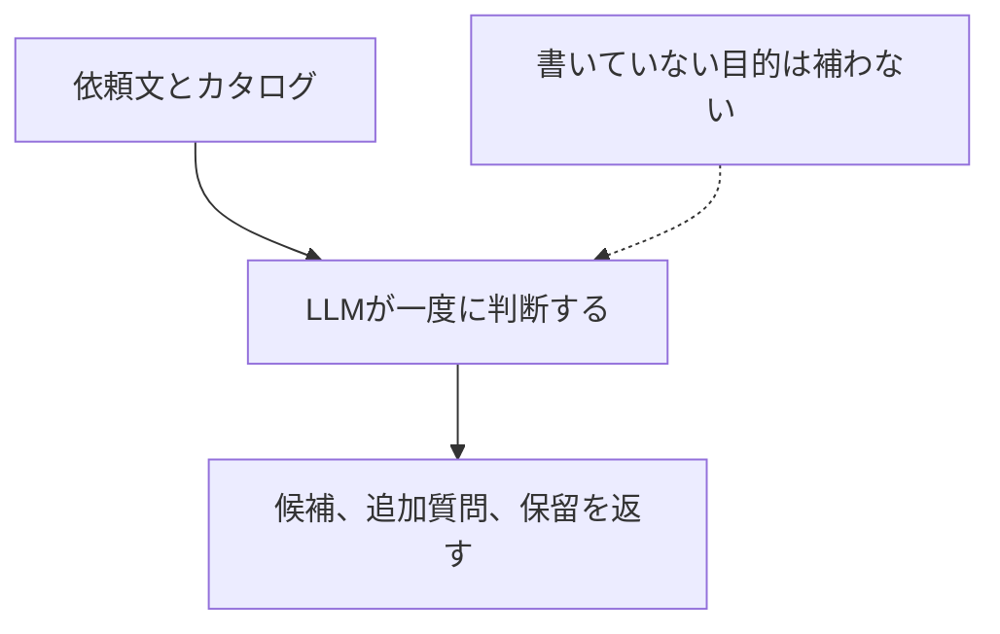
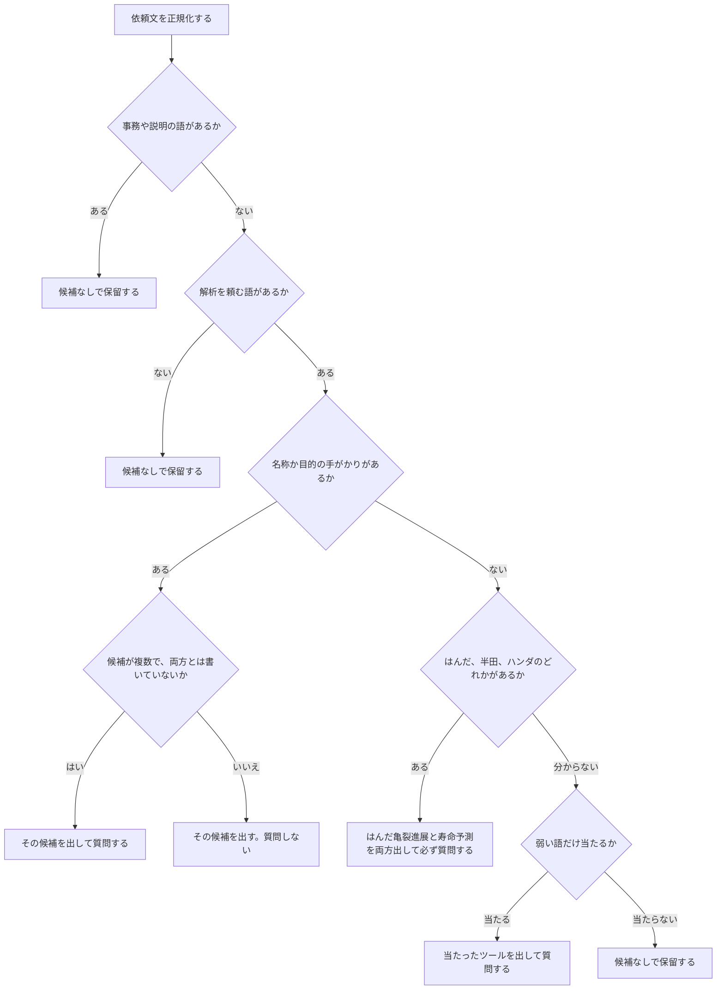
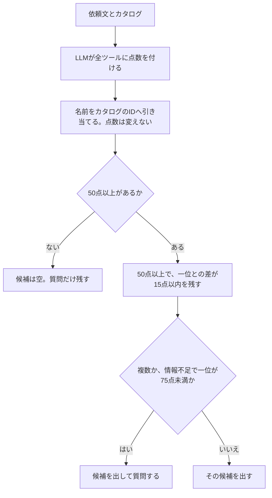
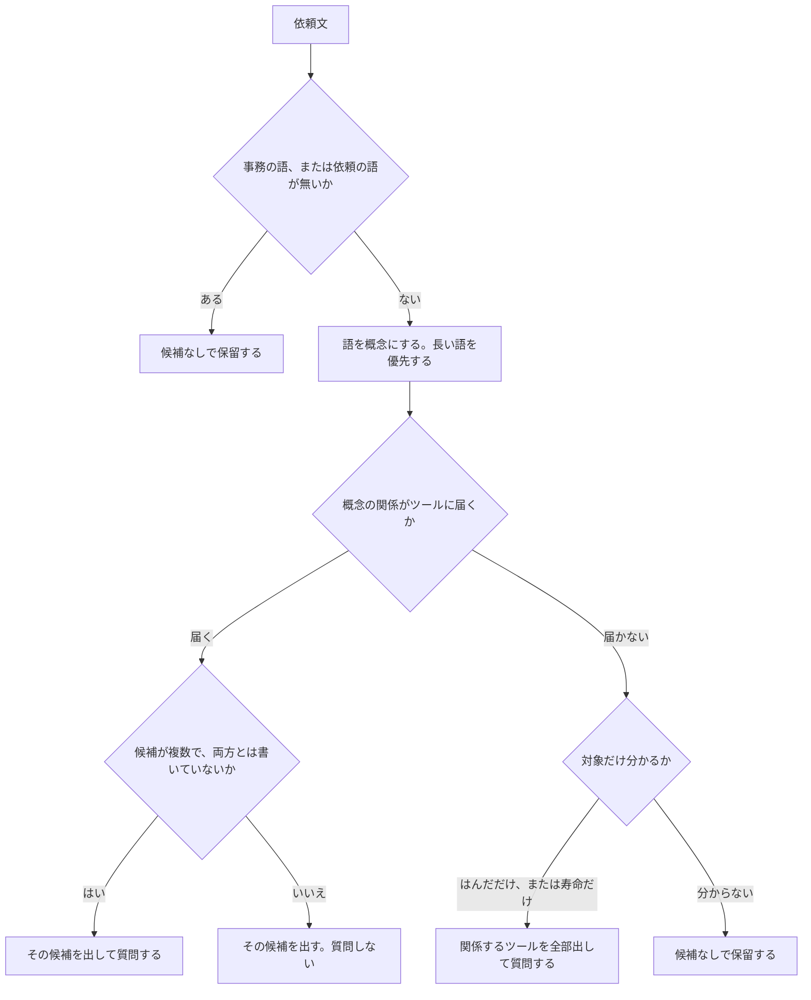

# 登録していない言い方が来たときのツール選択方式の比較

## 1. 目的

持たない、割れ、ソルダ、クラックのようにカタログに無い言い方が来たとき、どの方式がよいかを見る。辞書とオントロジーは三段階で比べる。①同義語未登録は、ソルダ、クラックのような別の言い方を教えていない。②同義語登録は、その言い方を同義語として教える。③同義語＋スラング登録は、②に持たない、割れを足す。比較は LangGraph 上で行い、解析そのものは実行しない。比較する方式は、LLM選択（方式A）、辞書・規則（方式B）、LLM採点＋しきい値（擬似jev）（方式C）、オントロジー（方式D）である。方式Dには、LLMを使わないものと、LLMが概念へ当てはめるものを含む。

## 2. 結論

36件では、オントロジーの③同義語＋スラング登録が相対的にいちばんよく、同率1位（候補集合の F1 は 0.991、不要な質問は 5.0%）である。次いでオントロジーの②同義語登録、その次は LLM選択で、辞書は同じ登録段階のオントロジーより下がる。LLM採点はモデルによる差が大きく、①同義語未登録がいちばん低い。

## 3. 条件（要領）

### 3.1 実行条件

- 実行日時: 2026-10-17
- テスト件数: 36
- 主カテゴリ内訳: 明確（目的が書いてある） 6件、表記ゆれ 7件、口語・俗称・略語 4件、複数ツールを明示 3件、曖昧（対象だけで目的が未定） 4件、暗黙の前提 3件、情報不足 3件、表層キーワードの引っかけ 3件、カタログ外 3件
- 正解ラベル: 実装者1名が付与した。024と025は、割れを亀裂、持たないを寿命とし、質問なしで1件にする判断に合わせ、実装者が後から直した。複数人の独立ラベルと不一致解消は行っていない。
- 条件番号は方式ごとの連番で、モデルは Sol、Terra、Luna の順に付ける。
- モデルID: Sol `gpt-5.6-sol-medium`、Terra `gpt-5.6-terra-medium`、Luna `gpt-5.6-luna-medium`。推論設定はモデルIDの medium。温度は指定できない。
- プログラム環境: Python 3.14.5、LangGraph 1.2.15、PyYAML 6.0.3。実行は Windows。
- 各方式の処理の流れは LangGraph で実装した。解析ツールを実行する機能は、この評価の処理には繋いでいない。

### 3.2 比較条件

番号は方式ごとの連番である。同じ番号でも方式が違えば別条件である。A1（LLM選択・Sol）と C1（LLM採点＋しきい値（擬似jev）・Sol）は、どちらも Sol だが別の実験である。

- LLM選択: LLM がカタログと依頼文を読み、候補、追加質問、保留を一度に返す。書いていない目的は補わない。
- 辞書・規則: LLM を使わない。カタログの名称、目的の手がかり、キーワードに紐づくツールの組、事務・説明表現の除外で候補を決める。どの規則が当たったかを残す。得点は付けない。
- LLM採点＋しきい値（擬似jev）: LLM がカタログの全ツールに適合度を付ける。別処理がツール ID をカタログから引き、得点の高さと差で、候補を出すか追加質問するかを決める。適合度は校正済みの確率ではない。
- オントロジー: 語を概念にし、関係でツールへ結ぶ。①はカタログの語だけである。D1 は LLM を使わない。D2、D3、D4 は LLM が概念へ当てはめ、候補は同じ関係が決める。

方式の違いは、同じ依頼を通すと分かる。下の辞書とオントロジーは①同義語未登録、LLM選択は A1、LLM採点は C1 の実測である。

| 依頼 | LLM選択 | 辞書・規則 | LLM採点＋しきい値（擬似jev） | オントロジー |
|---|---|---|---|---|
| はんだのシミュレーションをしたい | 亀裂進展とはんだ寿命を出して質問した。目的が書いていないと読んで、一つに決めなかった。 | 「はんだ」が組のキーワードに当たり、目的の語が無いので、亀裂進展とはんだ寿命を出して質問した。点数は無い。 | 亀裂進展 52、はんだ寿命 52、疲労 4。50以上が二つで差が15以内なので、両方出して質問した。 | 概念ははんだだけ。目的の概念が無いので、亀裂進展とはんだ寿命を出して質問した。 |
| ソルダのクラックグロース見たい | カタログに無い言い方を読んで、亀裂進展だけにした。質問しない。 | ソルダもクラックグロースも辞書に無い。候補は空で、何をしたいかを質問した。 | 亀裂進展 99、はんだ寿命 8、疲労 1。50以上は99だけなので、亀裂進展だけにした。質問しない。 | ソルダもクラックグロースも概念にならない。候補は空で保留した。 |

#### 3.2.1 LLM選択

A1、A2、A3 はこの流れである。モデルだけが違う。

上の1件目は、目的が書いていないので両方出して質問した。2件目は、ソルダとクラックグロースを LLM が読んで亀裂進展だけにした。

#### 3.2.2 辞書・規則

B1 はこの流れである。LLM は使わない。当たった規則は記録する。得点は付けない。

依頼を見る前に、カタログの言い方と、LLM には渡さない規則を持っている。

- 名称と別名。亀裂進展は「はんだ亀裂進展」「半田き裂進展」など。はんだ寿命は「はんだ寿命」「半田の寿命」など。疲労は「疲労寿命」「高サイクル疲労」。
- 目的の手がかり。亀裂進展は「亀裂進展」「き裂進展」「進展量」。はんだ寿命は「はんだ寿命」「熱疲労寿命」「寿命に達する」。疲労は「疲労寿命」「高サイクル疲労」「sn」「疲労」。
- 弱い語。亀裂、き裂、寿命。これだけではツールを決めず、質問する。
- 解析を頼む語。シミュレーション、見たい、したい、計算、予測など。
- 解析ではないとして捨てる語。意味、文献、化学分析、会議、使い方など。
- 組。はんだ、半田、ハンダが出て目的が無いとき、亀裂進展とはんだ寿命を両方出す。

段階で足す語は次のとおりである。折れはどの段階にも入れていない。

| 段階 | 事前に足してある語 |
|---|---|
| ①同義語未登録 | 上だけ。ソルダ、クラック、クラックグロース、割れ、持たないは持っていない |
| ②同義語登録 | ソルダを組のキーワードにする。クラックとクラックグロースを亀裂進展の別名にする |
| ③同義語＋スラング登録 | ②に加え、割れを亀裂進展の別名、持たないをはんだ寿命の別名にする |

はんだ、半田、ハンダは、はんだ用ツールの組を指すキーワードである。ソルダは入れていない。目的の手がかりが無いときにこのどれかがあると、はんだ亀裂進展シミュレーションとはんだ寿命予測シミュレーションを両方出し、必ず質問する。目的は一つに決めない。「両方」と書いてあっても、この分岐では質問をやめない。名称か目的の手がかりがあるときは、このキーワードには広げない。短い目的の語が、別ツールの長い語の一部なら、短い方は捨てる。

上の1件目は、「はんだ」が組のキーワードで目的の語が無いので両方出して質問した。2件目は、ソルダもクラックグロースも①の辞書に無いので候補が空である。②同義語登録では、この2件目は亀裂進展だけになる。

#### 3.2.3 LLM採点＋しきい値（擬似jev）

C1、C2、C3 はこの流れである。点数を付けるモデルだけが違う。点数は確率ではない。

上の1件目は 52 と 52 で差が15以内なので両方残して質問した。2件目は 99 だけが50以上なので亀裂進展だけにした。点数を候補に変える処理は、モデルが違っても同じである。

#### 3.2.4 オントロジー

D1 は LLM を使わない。D2、D3、D4 は LLM が依頼文を概念へ当てはめ、そのあとで同じ関係が候補を決める。

依頼を見る前に、語と概念の対応と、概念の組み合わせがどのツールに届くかを持っている。点数は持たない。①の概念は次のとおりである。

| 概念 | ①で持っている語 | ツールへの届き方 |
|---|---|---|
| はんだ | はんだ、半田、ハンダ | 亀裂とそろえば亀裂進展。寿命とそろえばはんだ寿命。はんだだけなら両方出して質問する |
| 亀裂 | 亀裂、き裂 | はんだとそろえば亀裂進展。進展とそろっても亀裂進展 |
| 進展 | 進展、進む | 亀裂とそろえば亀裂進展 |
| 寿命 | 寿命 | はんだとそろえばはんだ寿命。熱疲労とそろってもはんだ寿命。寿命だけならはんだ寿命と疲労寿命を出して質問する |
| 熱疲労 | 熱疲労 | 寿命とそろえばはんだ寿命 |
| 疲労 | 疲労、高サイクル疲労 | 寿命とそろえば疲労寿命。疲労だけでも疲労寿命 |
| 金属 | 金属 | ツールへは直接届かない |
| sn | sn | それだけで疲労寿命 |

段階で足す語は次のとおりである。関係そのものは変えない。折れはどの段階にも入れていない。

| 段階 | 事前に足してある語 |
|---|---|
| ①同義語未登録 | 上だけ。ソルダ、クラック、クラックグロース、割れ、持たないは概念にならない |
| ②同義語登録 | ソルダをはんだにする。クラックとクラックグロースを亀裂にする |
| ③同義語＋スラング登録 | ②に加え、割れを亀裂、持たないを寿命にする |

①では、登録していない語は概念にしない。上の2件目は概念が立たないので保留する。LLMありのときは、上の読み取りだけを LLM が行う。そのあとの関係は D1 と同じである。

D1 の読み取りで、依頼がどう分かれるかの例である。割れ、持たない、ソルダ、クラックは概念に入れていない。

| 依頼 | 立った概念 | 判断 | 候補 |
|---|---|---|---|
| 半田のき裂がどこまで進むかシミュレーションしたい | はんだ、亀裂、進展 | はんだと亀裂がそろった | はんだ亀裂進展シミュレーション。質問しない |
| 半田接合の熱疲労寿命を計算したい | はんだ、熱疲労、寿命 | 熱疲労は疲労より長いので、疲労は立たない。はんだと寿命がそろった | はんだ寿命予測シミュレーション。質問しない |
| はんだのシミュレーションをしたい | はんだ | 対象だけで、目的の概念が無い | はんだ亀裂進展シミュレーションとはんだ寿命予測シミュレーションを出して質問する |
| はんだが割れそうなので見たい | はんだ | 割れは概念にしない。はんだだけが残る | はんだ亀裂進展シミュレーションとはんだ寿命予測シミュレーションを出して質問する |
| 冷熱を繰り返すとはんだが持たない気がするので見たい | はんだ | 持たないは概念にしない。はんだだけが残る | はんだ亀裂進展シミュレーションとはんだ寿命予測シミュレーションを出して質問する |
| ソルダのクラックグロース見たい | なし | ソルダもクラックグロースも概念にしない | 候補なしで保留する |
| 鋼が繰り返しで折れそうなので寿命を見たい | 寿命 | 鋼と折れは概念にしない。寿命だけが残る | はんだ寿命予測シミュレーションと疲労寿命予測を出して質問する |
| はんだの成分を化学分析したい | はんだ | 化学分析は解析の実行ではない | 候補なしで保留する |
| ブラケットの固有振動数を計算したい | なし | 計算とはあるが、概念がツールまで届かない | 候補なしで保留する |

| 条件 | 方式 | モデル | この条件でやること |
|---|---|---|---|
| A1（LLM選択・Sol） | LLM選択 | Sol | Sol が共有カタログを読み、候補・追加質問・保留を直接返す。複数候補を返してよい。 |
| A2（LLM選択・Terra） | LLM選択 | Terra | Terra が共有カタログを読み、候補・追加質問・保留を直接返す。複数候補を返してよい。 |
| A3（LLM選択・Luna） | LLM選択 | Luna | Luna が共有カタログを読み、候補・追加質問・保留を直接返す。複数候補を返してよい。 |
| B1（辞書・規則・①同義語未登録） | 辞書・規則 | なし | モデルは使わない。カタログの語だけを使う。ソルダ、クラック、割れ、持たないは入れない。 |
| B2（辞書・規則・②同義語登録） | 辞書・規則 | なし | モデルは使わない。呼び方だけを足す。ソルダははんだ、クラックとクラックグロースは亀裂。割れと持たないは入れない。 |
| B3（辞書・規則・③同義語＋スラング登録） | 辞書・規則 | なし | 呼び方に加え、割れは亀裂、持たないは寿命として登録する。一つに決めない、とは書いていない。 |
| C1（LLM採点＋しきい値（擬似jev）・Sol） | LLM採点＋しきい値（擬似jev） | Sol | Sol が全ツールに適合度を付ける。別処理が ID をカタログで引き、得点の高さと差で候補を出すか質問するかを決める。適合度は確率ではない。 |
| C2（LLM採点＋しきい値（擬似jev）・Terra） | LLM採点＋しきい値（擬似jev） | Terra | Terra が全ツールに適合度を付ける。別処理が ID をカタログで引き、得点の高さと差で候補を出すか質問するかを決める。適合度は確率ではない。 |
| C3（LLM採点＋しきい値（擬似jev）・Luna） | LLM採点＋しきい値（擬似jev） | Luna | Luna が全ツールに適合度を付ける。別処理が ID をカタログで引き、得点の高さと差で候補を出すか質問するかを決める。適合度は確率ではない。 |
| D1（オントロジー・①同義語未登録） | オントロジー | なし | モデルは使わない。カタログに書いてある語だけを概念にし、関係でツールへ結ぶ。割れと持たないは概念にしない。 |
| D2（オントロジー＋LLM・Sol・①同義語未登録） | オントロジー＋LLM | Sol | Sol が依頼文を、この条件のラベル一覧にある概念へ当てはめる。ツールの決定はその関係が行う。 |
| D3（オントロジー＋LLM・Terra・①同義語未登録） | オントロジー＋LLM | Terra | Terra が依頼文を、この条件のラベル一覧にある概念へ当てはめる。ツールの決定はその関係が行う。 |
| D4（オントロジー＋LLM・Luna・①同義語未登録） | オントロジー＋LLM | Luna | Luna が依頼文を、この条件のラベル一覧にある概念へ当てはめる。ツールの決定はその関係が行う。 |
| D5（オントロジー・②同義語登録） | オントロジー | なし | モデルは使わない。ソルダははんだ、クラックとクラックグロースは亀裂。割れと持たないは概念にしない。 |
| D6（オントロジー＋LLM・Sol・②同義語登録） | オントロジー＋LLM | Sol | Sol が依頼文を、この条件のラベル一覧にある概念へ当てはめる。ツールの決定はその関係が行う。 |
| D7（オントロジー＋LLM・Terra・②同義語登録） | オントロジー＋LLM | Terra | Terra が依頼文を、この条件のラベル一覧にある概念へ当てはめる。ツールの決定はその関係が行う。 |
| D8（オントロジー＋LLM・Luna・②同義語登録） | オントロジー＋LLM | Luna | Luna が依頼文を、この条件のラベル一覧にある概念へ当てはめる。ツールの決定はその関係が行う。 |
| D9（オントロジー・③同義語＋スラング登録） | オントロジー | なし | モデルは使わない。割れは亀裂、持たないは寿命として概念にする。一つに決めない、とは書いていない。 |
| D10（オントロジー＋LLM・Sol・③同義語＋スラング登録） | オントロジー＋LLM | Sol | Sol が依頼文を、この条件のラベル一覧にある概念へ当てはめる。ツールの決定はその関係が行う。 |
| D11（オントロジー＋LLM・Terra・③同義語＋スラング登録） | オントロジー＋LLM | Terra | Terra が依頼文を、この条件のラベル一覧にある概念へ当てはめる。ツールの決定はその関係が行う。 |
| D12（オントロジー＋LLM・Luna・③同義語＋スラング登録） | オントロジー＋LLM | Luna | Luna が依頼文を、この条件のラベル一覧にある概念へ当てはめる。ツールの決定はその関係が行う。 |

### 3.3 評価指標

候補の正解は一つのツールに限らない。選ぶべきツールに入っていればそのツールは正解で、必須は必ず含めなければならない。質問すべきか、保留すべきかもラベルに含まれ、ユーザーが後から選んだ結果は精度に入れていない。

#### 3.3.1 候補集合のF1

出したツールの集合が、選ぶべきツールにどれだけ近いかを、依頼1件ごとに 0 から 1 で表した値である。表の数字は、その値を対象の依頼で平均したものである。全件の平均が総合の F1、種類ごとの平均がカテゴリ別の F1 である。

1件の計算は、次の二つを組み合わせる。

- 適合率は、出したツールのうち選ぶべきツールに入っていた割合である。余分なツールを足すと下がる。
- 再現率は、選ぶべきツールのうち出せていた割合である。出すべきツールを落とすと下がる。
- F1 は 2 × 適合率 × 再現率 ÷（適合率 + 再現率）である。どちらかが低いと、もう一方が高くても F1 は伸びない。

例は次のとおりである。

- 選ぶべきツールが疲労寿命予測だけで、それだけ出した。F1 は 1。
- 選ぶべきツールがはんだ亀裂進展とはんだ寿命予測の2件で、1件だけ出した。適合率は 1、再現率は 0.5、F1 は 0.667。
- 選ぶべきツールが1件で、その1件に加えて別のツールも出した。適合率は 0.5、再現率は 1、F1 は 0.667。
- 選ぶべきツールがあるのに候補が空、または選ぶべきツールが無いのに候補を出した。F1 は 0。
- 選ぶべきツールも候補も無い。出さないのが正解で出していないので、F1 は 1。

F1 が見ているのはツールの集合だけである。質問の有無は、下の表の「追加質問の妥当」と「不要な質問」で集計する。

| 指標 | 意味 | 読み方 |
|---|---|---|
| 候補集合のF1 | 上の計算を依頼ごとに行い、平均する。1 に近いほど、出してよいツールに近い。 | 1 なら過不足なく一致。0.667 は、2件中1件だけ出すか、正解1件に余分を1件足した程度。 |
| 完全一致 | 出した候補が選ぶべきツールとまったく同じだった割合。 | 高いほど、過不足なく一致している。 |
| 必須の包含 | 必須ツールがすべて予測に入っていた割合。必須が空のケースは分母に入らない。 | 高いほど、落としてはいけないツールを残せている。 |
| 単一正解 | 正解が1ツールのケースで、その1件だけを選べた割合。 | 高いほど、目的が一つの依頼を選べている。 |
| 複数候補の妥当 | 複数候補が期待されるケースで、必須を含み、選ぶべきツールの範囲に収まり、2件以上出している割合。 | 高いほど、迷う依頼で候補を狭めすぎていない。 |
| 追加質問の妥当 | 質問すべきケースで、質問すると判断し、質問文もある割合。 | 高いほど、確認が必要な依頼で質問できている。 |
| 不要な質問 | 質問しなくてよいケースで、それでも質問した割合。 | 低いほど、明確な依頼を止めずに進める。 |
| 未定なのに1件に絞った | 目的が一つに定まっておらず、候補を複数残して質問すべき依頼で、質問せず1件だけ出した割合。 | 低いほど、書いていない目的で1件に絞りすぎていない。 |
| 対象外の保留 | カタログ外、または適用が不明なケースで、候補を出さず保留した割合。 | 高いほど、カタログに無い依頼をツールに寄せていない。 |
| 処理エラー | 応答を候補に変換できなかった割合。選択の良し悪しではない。 | 0 なら、集計に乗らなかった応答はない。 |

カテゴリ別の値も同じ候補集合の F1 である。1件の依頼が複数カテゴリに入ることがある。誤り分類は規則による自動付与で、1件に複数の誤りが付く。人手で読み直した分類ではない。

## 4. 結果

### 4.1 順位

オントロジーの③同義語＋スラング登録が相対的にいちばんよい。D9 から D12 は同率1位で、候補集合の F1 は 0.991、不要な質問は 5.0% である。ソルダ、クラック、割れ、持たないが概念になり、関係まで届く。モデルによる差は無い。

次いでオントロジーの②同義語登録である。F1 は 0.972 で同率6位、Luna だけは 0.981 で5位である。同義語でソルダとクラックは選べる。割れと持たないが無いので、024と025は二つ出して質問し、③より下がる。

その次は LLM選択である。Sol は F1 0.963 で9位、Terra と Luna は 0.935 で11位と12位である。登録を渡さなくてもソルダとクラックを読める。024は二つ出して質問する。

辞書の③同義語＋スラング登録は F1 0.954 で10位、②同義語登録は 0.935 で13位である。登録した語は当たる。決まっている依頼への質問が残り、不要な質問は③で 30.0%、②で 40.0% なので、同じ登録段階のオントロジーより下がる。

LLM採点は系統の中で差が大きい。Sol は F1 0.907 で14位、Luna は 0.806 で20位、Terra は 0.778 で21位である。点数が足りず候補が空になる依頼がある。

①同義語未登録は、辞書が F1 0.870 で15位、オントロジーが 0.852 から 0.861 で16位から19位である。ソルダとクラックが登録に無く、候補が出ないか保留になる。オントロジーの Terra が一段低い。

内訳は下の表である。

| 順 | 条件 | 候補集合のF1 | 不要な質問 | 未定なのに1件に絞った | 追加質問の妥当 |
|---|---|---|---|---|---|
| 同率1位 | D9（オントロジー・③同義語＋スラング登録） | 0.991 | 5.0% | 0.0% | 100.0% |
| 同率1位 | D10（オントロジー＋LLM・Sol・③同義語＋スラング登録） | 0.991 | 5.0% | 0.0% | 100.0% |
| 同率1位 | D11（オントロジー＋LLM・Terra・③同義語＋スラング登録） | 0.991 | 5.0% | 0.0% | 100.0% |
| 同率1位 | D12（オントロジー＋LLM・Luna・③同義語＋スラング登録） | 0.991 | 5.0% | 0.0% | 100.0% |
| 5位 | D8（オントロジー＋LLM・Luna・②同義語登録） | 0.981 | 10.0% | 0.0% | 100.0% |
| 同率6位 | D5（オントロジー・②同義語登録） | 0.972 | 15.0% | 0.0% | 100.0% |
| 同率6位 | D6（オントロジー＋LLM・Sol・②同義語登録） | 0.972 | 15.0% | 0.0% | 100.0% |
| 同率6位 | D7（オントロジー＋LLM・Terra・②同義語登録） | 0.972 | 15.0% | 0.0% | 100.0% |
| 9位 | A1（LLM選択・Sol） | 0.963 | 10.0% | 0.0% | 62.5% |
| 10位 | B3（辞書・規則・③同義語＋スラング登録） | 0.954 | 30.0% | 0.0% | 100.0% |
| 11位 | A3（LLM選択・Luna） | 0.935 | 5.0% | 0.0% | 100.0% |
| 12位 | A2（LLM選択・Terra） | 0.935 | 5.0% | 0.0% | 62.5% |
| 13位 | B2（辞書・規則・②同義語登録） | 0.935 | 40.0% | 0.0% | 100.0% |
| 14位 | C1（LLM採点＋しきい値（擬似jev）・Sol） | 0.907 | 20.0% | 0.0% | 100.0% |
| 15位 | B1（辞書・規則・①同義語未登録） | 0.870 | 50.0% | 0.0% | 100.0% |
| 同率16位 | D1（オントロジー・①同義語未登録） | 0.861 | 30.0% | 0.0% | 100.0% |
| 同率16位 | D2（オントロジー＋LLM・Sol・①同義語未登録） | 0.861 | 30.0% | 0.0% | 100.0% |
| 同率16位 | D4（オントロジー＋LLM・Luna・①同義語未登録） | 0.861 | 30.0% | 0.0% | 100.0% |
| 19位 | D3（オントロジー＋LLM・Terra・①同義語未登録） | 0.852 | 30.0% | 0.0% | 100.0% |
| 20位 | C3（LLM採点＋しきい値（擬似jev）・Luna） | 0.806 | 25.0% | 0.0% | 100.0% |
| 21位 | C2（LLM採点＋しきい値（擬似jev）・Terra） | 0.778 | 20.0% | 0.0% | 100.0% |

### 4.2 依頼の種類ごとの候補集合F1

候補集合の F1 が 0.85 以上を「良い」、0.80 以上 0.85 未満を「中間」、0.80 未満を「弱い」とした。この区切りは一覧を見やすくするためのものである。

| 条件 | 明確（目的が書いてある） | 表記ゆれ | 口語・俗称・略語 | 複数ツールを明示 | 曖昧（対象だけで目的が未定） | 暗黙の前提 | 情報不足 | 表層キーワードの引っかけ | カタログ外 |
|---|---|---|---|---|---|---|---|---|---|
| D9（オントロジー・③同義語＋スラング登録） | 0.983（良い） | 1.000（良い） | 1.000（良い） | 1.000（良い） | 1.000（良い） | 0.889（良い） | 1.000（良い） | 1.000（良い） | 1.000（良い） |
| D10（オントロジー＋LLM・Sol・③同義語＋スラング登録） | 0.983（良い） | 1.000（良い） | 1.000（良い） | 1.000（良い） | 1.000（良い） | 0.889（良い） | 1.000（良い） | 1.000（良い） | 1.000（良い） |
| D11（オントロジー＋LLM・Terra・③同義語＋スラング登録） | 0.983（良い） | 1.000（良い） | 1.000（良い） | 1.000（良い） | 1.000（良い） | 0.889（良い） | 1.000（良い） | 1.000（良い） | 1.000（良い） |
| D12（オントロジー＋LLM・Luna・③同義語＋スラング登録） | 0.983（良い） | 1.000（良い） | 1.000（良い） | 1.000（良い） | 1.000（良い） | 0.889（良い） | 1.000（良い） | 1.000（良い） | 1.000（良い） |
| D8（オントロジー＋LLM・Luna・②同義語登録） | 0.967（良い） | 1.000（良い） | 1.000（良い） | 1.000（良い） | 1.000（良い） | 0.778（弱い） | 1.000（良い） | 1.000（良い） | 1.000（良い） |
| D5（オントロジー・②同義語登録） | 0.950（良い） | 1.000（良い） | 1.000（良い） | 1.000（良い） | 1.000（良い） | 0.667（弱い） | 1.000（良い） | 1.000（良い） | 1.000（良い） |
| D6（オントロジー＋LLM・Sol・②同義語登録） | 0.950（良い） | 1.000（良い） | 1.000（良い） | 1.000（良い） | 1.000（良い） | 0.667（弱い） | 1.000（良い） | 1.000（良い） | 1.000（良い） |
| D7（オントロジー＋LLM・Terra・②同義語登録） | 0.950（良い） | 1.000（良い） | 1.000（良い） | 1.000（良い） | 1.000（良い） | 0.667（弱い） | 1.000（良い） | 1.000（良い） | 1.000（良い） |
| A1（LLM選択・Sol） | 0.933（良い） | 1.000（良い） | 0.750（弱い） | 1.000（良い） | 1.000（良い） | 0.889（良い） | 1.000（良い） | 1.000（良い） | 1.000（良い） |
| B3（辞書・規則・③同義語＋スラング登録） | 0.917（良い） | 0.905（良い） | 1.000（良い） | 1.000（良い） | 1.000（良い） | 0.889（良い） | 1.000（良い） | 1.000（良い） | 1.000（良い） |
| A3（LLM選択・Luna） | 0.983（良い） | 1.000（良い） | 1.000（良い） | 1.000（良い） | 0.714（弱い） | 0.889（良い） | 1.000（良い） | 1.000（良い） | 1.000（良い） |
| A2（LLM選択・Terra） | 0.983（良い） | 1.000（良い） | 1.000（良い） | 1.000（良い） | 0.714（弱い） | 0.889（良い） | 1.000（良い） | 1.000（良い） | 1.000（良い） |
| B2（辞書・規則・②同義語登録） | 0.883（良い） | 0.905（良い） | 1.000（良い） | 1.000（良い） | 1.000（良い） | 0.667（弱い） | 1.000（良い） | 1.000（良い） | 1.000（良い） |
| C1（LLM採点＋しきい値（擬似jev）・Sol） | 0.983（良い） | 1.000（良い） | 1.000（良い） | 1.000（良い） | 0.571（弱い） | 0.889（良い） | 1.000（良い） | 1.000（良い） | 1.000（良い） |
| B1（辞書・規則・①同義語未登録） | 0.817（中間） | 0.905（良い） | 0.417（弱い） | 1.000（良い） | 0.857（良い） | 0.667（弱い） | 1.000（良い） | 1.000（良い） | 1.000（良い） |
| D1（オントロジー・①同義語未登録） | 0.800（中間） | 1.000（良い） | 0.250（弱い） | 1.000（良い） | 0.857（良い） | 0.667（弱い） | 1.000（良い） | 1.000（良い） | 1.000（良い） |
| D2（オントロジー＋LLM・Sol・①同義語未登録） | 0.800（中間） | 1.000（良い） | 0.250（弱い） | 1.000（良い） | 0.857（良い） | 0.667（弱い） | 1.000（良い） | 1.000（良い） | 1.000（良い） |
| D4（オントロジー＋LLM・Luna・①同義語未登録） | 0.800（中間） | 1.000（良い） | 0.250（弱い） | 1.000（良い） | 0.857（良い） | 0.667（弱い） | 1.000（良い） | 1.000（良い） | 1.000（良い） |
| D3（オントロジー＋LLM・Terra・①同義語未登録） | 0.783（弱い） | 1.000（良い） | 0.250（弱い） | 0.889（良い） | 0.857（良い） | 0.667（弱い） | 1.000（良い） | 1.000（良い） | 1.000（良い） |
| C3（LLM採点＋しきい値（擬似jev）・Luna） | 1.000（良い） | 0.714（弱い） | 0.750（弱い） | 1.000（良い） | 0.000（弱い） | 1.000（良い） | 1.000（良い） | 1.000（良い） | 1.000（良い） |
| C2（LLM採点＋しきい値（擬似jev）・Terra） | 0.950（良い） | 0.714（弱い） | 0.750（弱い） | 1.000（良い） | 0.000（弱い） | 0.667（弱い） | 1.000（良い） | 1.000（良い） | 1.000（良い） |

### 4.3 誤り

件数は自動規則で数えた。1件に複数の誤りが付くことがある。
次の誤りは全条件で 0件なので表から外した。過剰な意図補完、表層キーワード誤選択、過剰選択、質問不足、カタログ照合ミス、その他。

- 候補漏れ: 出すべきツールが候補に入っていない。質問だけして候補が空の場合も含む。
- 不適切な追加質問: 質問しなくてよい依頼なのに質問した。

| 条件 | 候補漏れ | 不適切な追加質問 |
|---|---|---|
| D9（オントロジー・③同義語＋スラング登録） | 0 | 1 |
| D10（オントロジー＋LLM・Sol・③同義語＋スラング登録） | 0 | 1 |
| D11（オントロジー＋LLM・Terra・③同義語＋スラング登録） | 0 | 1 |
| D12（オントロジー＋LLM・Luna・③同義語＋スラング登録） | 0 | 1 |
| D8（オントロジー＋LLM・Luna・②同義語登録） | 0 | 2 |
| D5（オントロジー・②同義語登録） | 0 | 3 |
| D6（オントロジー＋LLM・Sol・②同義語登録） | 0 | 3 |
| D7（オントロジー＋LLM・Terra・②同義語登録） | 0 | 3 |
| A1（LLM選択・Sol） | 1 | 2 |
| B3（辞書・規則・③同義語＋スラング登録） | 0 | 6 |
| A3（LLM選択・Luna） | 2 | 1 |
| A2（LLM選択・Terra） | 2 | 1 |
| B2（辞書・規則・②同義語登録） | 0 | 8 |
| C1（LLM採点＋しきい値（擬似jev）・Sol） | 3 | 4 |
| B1（辞書・規則・①同義語未登録） | 2 | 10 |
| D1（オントロジー・①同義語未登録） | 4 | 6 |
| D2（オントロジー＋LLM・Sol・①同義語未登録） | 4 | 6 |
| D4（オントロジー＋LLM・Luna・①同義語未登録） | 4 | 6 |
| D3（オントロジー＋LLM・Terra・①同義語未登録） | 5 | 6 |
| C3（LLM採点＋しきい値（擬似jev）・Luna） | 7 | 5 |
| C2（LLM採点＋しきい値（擬似jev）・Terra） | 8 | 4 |

### 4.4 安定性

複数回実行の結果は、このレポート生成時点では未実施。

### 4.5 同じ依頼での比較

候補漏れ、過剰な意図補完、表層キーワード誤選択が付いた依頼を、1条件・1種類あたり3件まで取り、21条件が何を候補にし、質問したかを並べた。判断は、選ぶべきツールと質問の有無を正解と比べた自動分類である。見出しの種類は、その依頼の主たる種類である。

適合度はLLM採点＋しきい値（擬似jev）が各ツールに付けた得点である。LLM選択と辞書・規則は得点を付けない。20以上を高い順に書き、どれも20未満のときは最高点だけを書いた。同点が4件以上なら最高点の数値だけにした。0は省いた。候補に入れる下限は50、一位との差が15以内を接近とみなす。情報不足でも、一位が75以上ならその理由だけでは質問しない。

#### 002　明確（目的が書いてある）　はんだクラックの進展量をサイクルごとに計算したい

種類: 明確（目的が書いてある）。選ぶべきツール: はんだ亀裂進展シミュレーション。質問の正解: しない。

| 条件 | 出した候補 | 適合度 | 質問 | 判断 |
|---|---|---|---|---|
| A1（LLM選択・Sol） | はんだ亀裂進展シミュレーション | — | なし | 選ぶべきツールと一致 |
| A2（LLM選択・Terra） | はんだ亀裂進展シミュレーション | — | なし | 選ぶべきツールと一致 |
| A3（LLM選択・Luna） | はんだ亀裂進展シミュレーション | — | なし | 選ぶべきツールと一致 |
| B1（辞書・規則・①同義語未登録） | はんだ亀裂進展シミュレーション | — | なし | 選ぶべきツールと一致 |
| B2（辞書・規則・②同義語登録） | はんだ亀裂進展シミュレーション | — | なし | 選ぶべきツールと一致 |
| B3（辞書・規則・③同義語＋スラング登録） | はんだ亀裂進展シミュレーション | — | なし | 選ぶべきツールと一致 |
| C1（LLM採点＋しきい値（擬似jev）・Sol） | はんだ亀裂進展シミュレーション | はんだ亀裂進展シミュレーション 100 | なし | 選ぶべきツールと一致 |
| C2（LLM採点＋しきい値（擬似jev）・Terra） | はんだ亀裂進展シミュレーション | はんだ亀裂進展シミュレーション 99、はんだ寿命予測シミュレーション 35 | なし | 選ぶべきツールと一致 |
| C3（LLM採点＋しきい値（擬似jev）・Luna） | はんだ亀裂進展シミュレーション | はんだ亀裂進展シミュレーション 98、はんだ寿命予測シミュレーション 30 | なし | 選ぶべきツールと一致 |
| D1（オントロジー・①同義語未登録） | なし | — | あり。どの解析を実行したいか、対象と知りたいことを教えてください。 | 候補漏れ、不適切な追加質問 |
| D2（オントロジー＋LLM・Sol・①同義語未登録） | なし | — | あり。どの解析を実行したいか、対象と知りたいことを教えてください。 | 候補漏れ、不適切な追加質問 |
| D3（オントロジー＋LLM・Terra・①同義語未登録） | なし | — | あり。どの解析を実行したいか、対象と知りたいことを教えてください。 | 候補漏れ、不適切な追加質問 |
| D4（オントロジー＋LLM・Luna・①同義語未登録） | なし | — | あり。どの解析を実行したいか、対象と知りたいことを教えてください。 | 候補漏れ、不適切な追加質問 |
| D5（オントロジー・②同義語登録） | はんだ亀裂進展シミュレーション | — | なし | 選ぶべきツールと一致 |
| D6（オントロジー＋LLM・Sol・②同義語登録） | はんだ亀裂進展シミュレーション | — | なし | 選ぶべきツールと一致 |
| D7（オントロジー＋LLM・Terra・②同義語登録） | はんだ亀裂進展シミュレーション | — | なし | 選ぶべきツールと一致 |
| D8（オントロジー＋LLM・Luna・②同義語登録） | はんだ亀裂進展シミュレーション | — | なし | 選ぶべきツールと一致 |
| D9（オントロジー・③同義語＋スラング登録） | はんだ亀裂進展シミュレーション | — | なし | 選ぶべきツールと一致 |
| D10（オントロジー＋LLM・Sol・③同義語＋スラング登録） | はんだ亀裂進展シミュレーション | — | なし | 選ぶべきツールと一致 |
| D11（オントロジー＋LLM・Terra・③同義語＋スラング登録） | はんだ亀裂進展シミュレーション | — | なし | 選ぶべきツールと一致 |
| D12（オントロジー＋LLM・Luna・③同義語＋スラング登録） | はんだ亀裂進展シミュレーション | — | なし | 選ぶべきツールと一致 |

#### 007　表記ゆれ　半田のシミュレーションをしたい

種類: 表記ゆれ。重なる種類: 曖昧（対象だけで目的が未定）。選ぶべきツール: はんだ亀裂進展シミュレーション、はんだ寿命予測シミュレーション。質問の正解: する。

| 条件 | 出した候補 | 適合度 | 質問 | 判断 |
|---|---|---|---|---|
| A1（LLM選択・Sol） | はんだ亀裂進展シミュレーション、はんだ寿命予測シミュレーション | — | あり。半田の亀裂の進み方と寿命サイクル数のどちらを求めますか？ | 選ぶべきツールと一致 |
| A2（LLM選択・Terra） | はんだ亀裂進展シミュレーション、はんだ寿命予測シミュレーション | — | あり。はんだ接合の亀裂の進み方と寿命回数のどちらを確認したいですか？ | 選ぶべきツールと一致 |
| A3（LLM選択・Luna） | はんだ亀裂進展シミュレーション、はんだ寿命予測シミュレーション | — | あり。亀裂の進み方と寿命回数のどちらを求めますか？ | 選ぶべきツールと一致 |
| B1（辞書・規則・①同義語未登録） | はんだ亀裂進展シミュレーション、はんだ寿命予測シミュレーション | — | あり。次のどれが目的に近いですか。はんだ亀裂進展シミュレーション、はんだ寿命予測シミュレーション | 選ぶべきツールと一致 |
| B2（辞書・規則・②同義語登録） | はんだ亀裂進展シミュレーション、はんだ寿命予測シミュレーション | — | あり。次のどれが目的に近いですか。はんだ亀裂進展シミュレーション、はんだ寿命予測シミュレーション | 選ぶべきツールと一致 |
| B3（辞書・規則・③同義語＋スラング登録） | はんだ亀裂進展シミュレーション、はんだ寿命予測シミュレーション | — | あり。次のどれが目的に近いですか。はんだ亀裂進展シミュレーション、はんだ寿命予測シミュレーション | 選ぶべきツールと一致 |
| C1（LLM採点＋しきい値（擬似jev）・Sol） | はんだ亀裂進展シミュレーション、はんだ寿命予測シミュレーション | はんだ亀裂進展シミュレーション 52、はんだ寿命予測シミュレーション 52 | あり。次を教えてください。亀裂進展と寿命予測のどちらが目的か | 選ぶべきツールと一致 |
| C2（LLM採点＋しきい値（擬似jev）・Terra） | なし | はんだ亀裂進展シミュレーション 45、はんだ寿命予測シミュレーション 45 | あり。適合度がどれも低いです。解析の対象と、何を知りたいかを教えてください。 | 候補漏れ |
| C3（LLM採点＋しきい値（擬似jev）・Luna） | なし | はんだ亀裂進展シミュレーション 35、はんだ寿命予測シミュレーション 35 | あり。適合度がどれも低いです。解析の対象と、何を知りたいかを教えてください。 | 候補漏れ |
| D1（オントロジー・①同義語未登録） | はんだ亀裂進展シミュレーション、はんだ寿命予測シミュレーション | — | あり。次のどれが目的に近いですか。はんだ亀裂進展シミュレーション、はんだ寿命予測シミュレーション | 選ぶべきツールと一致 |
| D2（オントロジー＋LLM・Sol・①同義語未登録） | はんだ亀裂進展シミュレーション、はんだ寿命予測シミュレーション | — | あり。次のどれが目的に近いですか。はんだ亀裂進展シミュレーション、はんだ寿命予測シミュレーション | 選ぶべきツールと一致 |
| D3（オントロジー＋LLM・Terra・①同義語未登録） | はんだ亀裂進展シミュレーション、はんだ寿命予測シミュレーション | — | あり。次のどれが目的に近いですか。はんだ亀裂進展シミュレーション、はんだ寿命予測シミュレーション | 選ぶべきツールと一致 |
| D4（オントロジー＋LLM・Luna・①同義語未登録） | はんだ亀裂進展シミュレーション、はんだ寿命予測シミュレーション | — | あり。次のどれが目的に近いですか。はんだ亀裂進展シミュレーション、はんだ寿命予測シミュレーション | 選ぶべきツールと一致 |
| D5（オントロジー・②同義語登録） | はんだ亀裂進展シミュレーション、はんだ寿命予測シミュレーション | — | あり。次のどれが目的に近いですか。はんだ亀裂進展シミュレーション、はんだ寿命予測シミュレーション | 選ぶべきツールと一致 |
| D6（オントロジー＋LLM・Sol・②同義語登録） | はんだ亀裂進展シミュレーション、はんだ寿命予測シミュレーション | — | あり。次のどれが目的に近いですか。はんだ亀裂進展シミュレーション、はんだ寿命予測シミュレーション | 選ぶべきツールと一致 |
| D7（オントロジー＋LLM・Terra・②同義語登録） | はんだ亀裂進展シミュレーション、はんだ寿命予測シミュレーション | — | あり。次のどれが目的に近いですか。はんだ亀裂進展シミュレーション、はんだ寿命予測シミュレーション | 選ぶべきツールと一致 |
| D8（オントロジー＋LLM・Luna・②同義語登録） | はんだ亀裂進展シミュレーション、はんだ寿命予測シミュレーション | — | あり。次のどれが目的に近いですか。はんだ亀裂進展シミュレーション、はんだ寿命予測シミュレーション | 選ぶべきツールと一致 |
| D9（オントロジー・③同義語＋スラング登録） | はんだ亀裂進展シミュレーション、はんだ寿命予測シミュレーション | — | あり。次のどれが目的に近いですか。はんだ亀裂進展シミュレーション、はんだ寿命予測シミュレーション | 選ぶべきツールと一致 |
| D10（オントロジー＋LLM・Sol・③同義語＋スラング登録） | はんだ亀裂進展シミュレーション、はんだ寿命予測シミュレーション | — | あり。次のどれが目的に近いですか。はんだ亀裂進展シミュレーション、はんだ寿命予測シミュレーション | 選ぶべきツールと一致 |
| D11（オントロジー＋LLM・Terra・③同義語＋スラング登録） | はんだ亀裂進展シミュレーション、はんだ寿命予測シミュレーション | — | あり。次のどれが目的に近いですか。はんだ亀裂進展シミュレーション、はんだ寿命予測シミュレーション | 選ぶべきツールと一致 |
| D12（オントロジー＋LLM・Luna・③同義語＋スラング登録） | はんだ亀裂進展シミュレーション、はんだ寿命予測シミュレーション | — | あり。次のどれが目的に近いですか。はんだ亀裂進展シミュレーション、はんだ寿命予測シミュレーション | 選ぶべきツールと一致 |

#### 008　表記ゆれ　ハンダのシミュレーションをしたい

種類: 表記ゆれ。重なる種類: 曖昧（対象だけで目的が未定）。選ぶべきツール: はんだ亀裂進展シミュレーション、はんだ寿命予測シミュレーション。質問の正解: する。

| 条件 | 出した候補 | 適合度 | 質問 | 判断 |
|---|---|---|---|---|
| A1（LLM選択・Sol） | はんだ亀裂進展シミュレーション、はんだ寿命予測シミュレーション | — | あり。ハンダの亀裂の進み方と寿命サイクル数のどちらを求めますか？ | 選ぶべきツールと一致 |
| A2（LLM選択・Terra） | はんだ亀裂進展シミュレーション、はんだ寿命予測シミュレーション | — | あり。ハンダ接合の亀裂の進み方と寿命回数のどちらを確認したいですか？ | 選ぶべきツールと一致 |
| A3（LLM選択・Luna） | はんだ亀裂進展シミュレーション、はんだ寿命予測シミュレーション | — | あり。亀裂の進み方と寿命回数のどちらを求めますか？ | 選ぶべきツールと一致 |
| B1（辞書・規則・①同義語未登録） | はんだ亀裂進展シミュレーション、はんだ寿命予測シミュレーション | — | あり。次のどれが目的に近いですか。はんだ亀裂進展シミュレーション、はんだ寿命予測シミュレーション | 選ぶべきツールと一致 |
| B2（辞書・規則・②同義語登録） | はんだ亀裂進展シミュレーション、はんだ寿命予測シミュレーション | — | あり。次のどれが目的に近いですか。はんだ亀裂進展シミュレーション、はんだ寿命予測シミュレーション | 選ぶべきツールと一致 |
| B3（辞書・規則・③同義語＋スラング登録） | はんだ亀裂進展シミュレーション、はんだ寿命予測シミュレーション | — | あり。次のどれが目的に近いですか。はんだ亀裂進展シミュレーション、はんだ寿命予測シミュレーション | 選ぶべきツールと一致 |
| C1（LLM採点＋しきい値（擬似jev）・Sol） | はんだ亀裂進展シミュレーション、はんだ寿命予測シミュレーション | はんだ亀裂進展シミュレーション 52、はんだ寿命予測シミュレーション 52 | あり。次を教えてください。亀裂進展と寿命予測のどちらが目的か | 選ぶべきツールと一致 |
| C2（LLM採点＋しきい値（擬似jev）・Terra） | なし | はんだ亀裂進展シミュレーション 45、はんだ寿命予測シミュレーション 45 | あり。適合度がどれも低いです。解析の対象と、何を知りたいかを教えてください。 | 候補漏れ |
| C3（LLM採点＋しきい値（擬似jev）・Luna） | なし | はんだ亀裂進展シミュレーション 35、はんだ寿命予測シミュレーション 35 | あり。適合度がどれも低いです。解析の対象と、何を知りたいかを教えてください。 | 候補漏れ |
| D1（オントロジー・①同義語未登録） | はんだ亀裂進展シミュレーション、はんだ寿命予測シミュレーション | — | あり。次のどれが目的に近いですか。はんだ亀裂進展シミュレーション、はんだ寿命予測シミュレーション | 選ぶべきツールと一致 |
| D2（オントロジー＋LLM・Sol・①同義語未登録） | はんだ亀裂進展シミュレーション、はんだ寿命予測シミュレーション | — | あり。次のどれが目的に近いですか。はんだ亀裂進展シミュレーション、はんだ寿命予測シミュレーション | 選ぶべきツールと一致 |
| D3（オントロジー＋LLM・Terra・①同義語未登録） | はんだ亀裂進展シミュレーション、はんだ寿命予測シミュレーション | — | あり。次のどれが目的に近いですか。はんだ亀裂進展シミュレーション、はんだ寿命予測シミュレーション | 選ぶべきツールと一致 |
| D4（オントロジー＋LLM・Luna・①同義語未登録） | はんだ亀裂進展シミュレーション、はんだ寿命予測シミュレーション | — | あり。次のどれが目的に近いですか。はんだ亀裂進展シミュレーション、はんだ寿命予測シミュレーション | 選ぶべきツールと一致 |
| D5（オントロジー・②同義語登録） | はんだ亀裂進展シミュレーション、はんだ寿命予測シミュレーション | — | あり。次のどれが目的に近いですか。はんだ亀裂進展シミュレーション、はんだ寿命予測シミュレーション | 選ぶべきツールと一致 |
| D6（オントロジー＋LLM・Sol・②同義語登録） | はんだ亀裂進展シミュレーション、はんだ寿命予測シミュレーション | — | あり。次のどれが目的に近いですか。はんだ亀裂進展シミュレーション、はんだ寿命予測シミュレーション | 選ぶべきツールと一致 |
| D7（オントロジー＋LLM・Terra・②同義語登録） | はんだ亀裂進展シミュレーション、はんだ寿命予測シミュレーション | — | あり。次のどれが目的に近いですか。はんだ亀裂進展シミュレーション、はんだ寿命予測シミュレーション | 選ぶべきツールと一致 |
| D8（オントロジー＋LLM・Luna・②同義語登録） | はんだ亀裂進展シミュレーション、はんだ寿命予測シミュレーション | — | あり。次のどれが目的に近いですか。はんだ亀裂進展シミュレーション、はんだ寿命予測シミュレーション | 選ぶべきツールと一致 |
| D9（オントロジー・③同義語＋スラング登録） | はんだ亀裂進展シミュレーション、はんだ寿命予測シミュレーション | — | あり。次のどれが目的に近いですか。はんだ亀裂進展シミュレーション、はんだ寿命予測シミュレーション | 選ぶべきツールと一致 |
| D10（オントロジー＋LLM・Sol・③同義語＋スラング登録） | はんだ亀裂進展シミュレーション、はんだ寿命予測シミュレーション | — | あり。次のどれが目的に近いですか。はんだ亀裂進展シミュレーション、はんだ寿命予測シミュレーション | 選ぶべきツールと一致 |
| D11（オントロジー＋LLM・Terra・③同義語＋スラング登録） | はんだ亀裂進展シミュレーション、はんだ寿命予測シミュレーション | — | あり。次のどれが目的に近いですか。はんだ亀裂進展シミュレーション、はんだ寿命予測シミュレーション | 選ぶべきツールと一致 |
| D12（オントロジー＋LLM・Luna・③同義語＋スラング登録） | はんだ亀裂進展シミュレーション、はんだ寿命予測シミュレーション | — | あり。次のどれが目的に近いですか。はんだ亀裂進展シミュレーション、はんだ寿命予測シミュレーション | 選ぶべきツールと一致 |

#### 013　口語・俗称・略語　ソルダの解析をお願いします

種類: 口語・俗称・略語。重なる種類: 曖昧（対象だけで目的が未定）。選ぶべきツール: はんだ亀裂進展シミュレーション、はんだ寿命予測シミュレーション。質問の正解: する。

| 条件 | 出した候補 | 適合度 | 質問 | 判断 |
|---|---|---|---|---|
| A1（LLM選択・Sol） | はんだ亀裂進展シミュレーション、はんだ寿命予測シミュレーション | — | あり。ソルダの亀裂の進み方と寿命サイクル数のどちらを求めますか？ | 選ぶべきツールと一致 |
| A2（LLM選択・Terra） | はんだ亀裂進展シミュレーション、はんだ寿命予測シミュレーション | — | あり。ソルダ接合について、亀裂の進み方と寿命回数のどちらを解析したいですか？ | 選ぶべきツールと一致 |
| A3（LLM選択・Luna） | はんだ亀裂進展シミュレーション、はんだ寿命予測シミュレーション | — | あり。亀裂の進展と寿命回数のどちらを解析しますか？ | 選ぶべきツールと一致 |
| B1（辞書・規則・①同義語未登録） | なし | — | あり。どの解析を実行したいか、対象と知りたいことを教えてください。 | 候補漏れ |
| B2（辞書・規則・②同義語登録） | はんだ亀裂進展シミュレーション、はんだ寿命予測シミュレーション | — | あり。次のどれが目的に近いですか。はんだ亀裂進展シミュレーション、はんだ寿命予測シミュレーション | 選ぶべきツールと一致 |
| B3（辞書・規則・③同義語＋スラング登録） | はんだ亀裂進展シミュレーション、はんだ寿命予測シミュレーション | — | あり。次のどれが目的に近いですか。はんだ亀裂進展シミュレーション、はんだ寿命予測シミュレーション | 選ぶべきツールと一致 |
| C1（LLM採点＋しきい値（擬似jev）・Sol） | はんだ亀裂進展シミュレーション、はんだ寿命予測シミュレーション | はんだ亀裂進展シミュレーション 50、はんだ寿命予測シミュレーション 50 | あり。次を教えてください。解析目的が亀裂進展か寿命予測か | 選ぶべきツールと一致 |
| C2（LLM採点＋しきい値（擬似jev）・Terra） | なし | はんだ亀裂進展シミュレーション 40、はんだ寿命予測シミュレーション 40 | あり。適合度がどれも低いです。解析の対象と、何を知りたいかを教えてください。 | 候補漏れ |
| C3（LLM採点＋しきい値（擬似jev）・Luna） | なし | はんだ亀裂進展シミュレーション 35、はんだ寿命予測シミュレーション 35 | あり。適合度がどれも低いです。解析の対象と、何を知りたいかを教えてください。 | 候補漏れ |
| D1（オントロジー・①同義語未登録） | なし | — | あり。どの解析を実行したいか、対象と知りたいことを教えてください。 | 候補漏れ |
| D2（オントロジー＋LLM・Sol・①同義語未登録） | なし | — | あり。どの解析を実行したいか、対象と知りたいことを教えてください。 | 候補漏れ |
| D3（オントロジー＋LLM・Terra・①同義語未登録） | なし | — | あり。どの解析を実行したいか、対象と知りたいことを教えてください。 | 候補漏れ |
| D4（オントロジー＋LLM・Luna・①同義語未登録） | なし | — | あり。どの解析を実行したいか、対象と知りたいことを教えてください。 | 候補漏れ |
| D5（オントロジー・②同義語登録） | はんだ亀裂進展シミュレーション、はんだ寿命予測シミュレーション | — | あり。次のどれが目的に近いですか。はんだ亀裂進展シミュレーション、はんだ寿命予測シミュレーション | 選ぶべきツールと一致 |
| D6（オントロジー＋LLM・Sol・②同義語登録） | はんだ亀裂進展シミュレーション、はんだ寿命予測シミュレーション | — | あり。次のどれが目的に近いですか。はんだ亀裂進展シミュレーション、はんだ寿命予測シミュレーション | 選ぶべきツールと一致 |
| D7（オントロジー＋LLM・Terra・②同義語登録） | はんだ亀裂進展シミュレーション、はんだ寿命予測シミュレーション | — | あり。次のどれが目的に近いですか。はんだ亀裂進展シミュレーション、はんだ寿命予測シミュレーション | 選ぶべきツールと一致 |
| D8（オントロジー＋LLM・Luna・②同義語登録） | はんだ亀裂進展シミュレーション、はんだ寿命予測シミュレーション | — | あり。次のどれが目的に近いですか。はんだ亀裂進展シミュレーション、はんだ寿命予測シミュレーション | 選ぶべきツールと一致 |
| D9（オントロジー・③同義語＋スラング登録） | はんだ亀裂進展シミュレーション、はんだ寿命予測シミュレーション | — | あり。次のどれが目的に近いですか。はんだ亀裂進展シミュレーション、はんだ寿命予測シミュレーション | 選ぶべきツールと一致 |
| D10（オントロジー＋LLM・Sol・③同義語＋スラング登録） | はんだ亀裂進展シミュレーション、はんだ寿命予測シミュレーション | — | あり。次のどれが目的に近いですか。はんだ亀裂進展シミュレーション、はんだ寿命予測シミュレーション | 選ぶべきツールと一致 |
| D11（オントロジー＋LLM・Terra・③同義語＋スラング登録） | はんだ亀裂進展シミュレーション、はんだ寿命予測シミュレーション | — | あり。次のどれが目的に近いですか。はんだ亀裂進展シミュレーション、はんだ寿命予測シミュレーション | 選ぶべきツールと一致 |
| D12（オントロジー＋LLM・Luna・③同義語＋スラング登録） | はんだ亀裂進展シミュレーション、はんだ寿命予測シミュレーション | — | あり。次のどれが目的に近いですか。はんだ亀裂進展シミュレーション、はんだ寿命予測シミュレーション | 選ぶべきツールと一致 |

#### 014　口語・俗称・略語　はんだのクラックが進むやつ回して

種類: 口語・俗称・略語。重なる種類: 明確（目的が書いてある）。選ぶべきツール: はんだ亀裂進展シミュレーション。質問の正解: しない。

| 条件 | 出した候補 | 適合度 | 質問 | 判断 |
|---|---|---|---|---|
| A1（LLM選択・Sol） | はんだ亀裂進展シミュレーション | — | なし | 選ぶべきツールと一致 |
| A2（LLM選択・Terra） | はんだ亀裂進展シミュレーション | — | なし | 選ぶべきツールと一致 |
| A3（LLM選択・Luna） | はんだ亀裂進展シミュレーション | — | なし | 選ぶべきツールと一致 |
| B1（辞書・規則・①同義語未登録） | はんだ亀裂進展シミュレーション、はんだ寿命予測シミュレーション | — | あり。次のどれが目的に近いですか。はんだ亀裂進展シミュレーション、はんだ寿命予測シミュレーション | 不適切な追加質問 |
| B2（辞書・規則・②同義語登録） | はんだ亀裂進展シミュレーション | — | なし | 選ぶべきツールと一致 |
| B3（辞書・規則・③同義語＋スラング登録） | はんだ亀裂進展シミュレーション | — | なし | 選ぶべきツールと一致 |
| C1（LLM採点＋しきい値（擬似jev）・Sol） | はんだ亀裂進展シミュレーション | はんだ亀裂進展シミュレーション 98 | なし | 選ぶべきツールと一致 |
| C2（LLM採点＋しきい値（擬似jev）・Terra） | はんだ亀裂進展シミュレーション | はんだ亀裂進展シミュレーション 99 | なし | 選ぶべきツールと一致 |
| C3（LLM採点＋しきい値（擬似jev）・Luna） | はんだ亀裂進展シミュレーション | はんだ亀裂進展シミュレーション 90、はんだ寿命予測シミュレーション 20 | なし | 選ぶべきツールと一致 |
| D1（オントロジー・①同義語未登録） | なし | — | あり。どの解析を実行したいか、対象と知りたいことを教えてください。 | 候補漏れ、不適切な追加質問 |
| D2（オントロジー＋LLM・Sol・①同義語未登録） | なし | — | あり。どの解析を実行したいか、対象と知りたいことを教えてください。 | 候補漏れ、不適切な追加質問 |
| D3（オントロジー＋LLM・Terra・①同義語未登録） | なし | — | あり。どの解析を実行したいか、対象と知りたいことを教えてください。 | 候補漏れ、不適切な追加質問 |
| D4（オントロジー＋LLM・Luna・①同義語未登録） | なし | — | あり。どの解析を実行したいか、対象と知りたいことを教えてください。 | 候補漏れ、不適切な追加質問 |
| D5（オントロジー・②同義語登録） | はんだ亀裂進展シミュレーション | — | なし | 選ぶべきツールと一致 |
| D6（オントロジー＋LLM・Sol・②同義語登録） | はんだ亀裂進展シミュレーション | — | なし | 選ぶべきツールと一致 |
| D7（オントロジー＋LLM・Terra・②同義語登録） | はんだ亀裂進展シミュレーション | — | なし | 選ぶべきツールと一致 |
| D8（オントロジー＋LLM・Luna・②同義語登録） | はんだ亀裂進展シミュレーション | — | なし | 選ぶべきツールと一致 |
| D9（オントロジー・③同義語＋スラング登録） | はんだ亀裂進展シミュレーション | — | なし | 選ぶべきツールと一致 |
| D10（オントロジー＋LLM・Sol・③同義語＋スラング登録） | はんだ亀裂進展シミュレーション | — | なし | 選ぶべきツールと一致 |
| D11（オントロジー＋LLM・Terra・③同義語＋スラング登録） | はんだ亀裂進展シミュレーション | — | なし | 選ぶべきツールと一致 |
| D12（オントロジー＋LLM・Luna・③同義語＋スラング登録） | はんだ亀裂進展シミュレーション | — | なし | 選ぶべきツールと一致 |

#### 015　口語・俗称・略語　ソルダのクラックグロース見たい

種類: 口語・俗称・略語。重なる種類: 明確（目的が書いてある）。選ぶべきツール: はんだ亀裂進展シミュレーション。質問の正解: しない。

| 条件 | 出した候補 | 適合度 | 質問 | 判断 |
|---|---|---|---|---|
| A1（LLM選択・Sol） | はんだ亀裂進展シミュレーション | — | なし | 選ぶべきツールと一致 |
| A2（LLM選択・Terra） | はんだ亀裂進展シミュレーション | — | なし | 選ぶべきツールと一致 |
| A3（LLM選択・Luna） | はんだ亀裂進展シミュレーション | — | なし | 選ぶべきツールと一致 |
| B1（辞書・規則・①同義語未登録） | なし | — | あり。どの解析を実行したいか、対象と知りたいことを教えてください。 | 候補漏れ、不適切な追加質問 |
| B2（辞書・規則・②同義語登録） | はんだ亀裂進展シミュレーション | — | なし | 選ぶべきツールと一致 |
| B3（辞書・規則・③同義語＋スラング登録） | はんだ亀裂進展シミュレーション | — | なし | 選ぶべきツールと一致 |
| C1（LLM採点＋しきい値（擬似jev）・Sol） | はんだ亀裂進展シミュレーション | はんだ亀裂進展シミュレーション 99 | なし | 選ぶべきツールと一致 |
| C2（LLM採点＋しきい値（擬似jev）・Terra） | はんだ亀裂進展シミュレーション | はんだ亀裂進展シミュレーション 99 | なし | 選ぶべきツールと一致 |
| C3（LLM採点＋しきい値（擬似jev）・Luna） | はんだ亀裂進展シミュレーション | はんだ亀裂進展シミュレーション 92、はんだ寿命予測シミュレーション 20 | なし | 選ぶべきツールと一致 |
| D1（オントロジー・①同義語未登録） | なし | — | あり。どの解析を実行したいか、対象と知りたいことを教えてください。 | 候補漏れ、不適切な追加質問 |
| D2（オントロジー＋LLM・Sol・①同義語未登録） | なし | — | あり。どの解析を実行したいか、対象と知りたいことを教えてください。 | 候補漏れ、不適切な追加質問 |
| D3（オントロジー＋LLM・Terra・①同義語未登録） | なし | — | あり。どの解析を実行したいか、対象と知りたいことを教えてください。 | 候補漏れ、不適切な追加質問 |
| D4（オントロジー＋LLM・Luna・①同義語未登録） | なし | — | あり。どの解析を実行したいか、対象と知りたいことを教えてください。 | 候補漏れ、不適切な追加質問 |
| D5（オントロジー・②同義語登録） | はんだ亀裂進展シミュレーション | — | なし | 選ぶべきツールと一致 |
| D6（オントロジー＋LLM・Sol・②同義語登録） | はんだ亀裂進展シミュレーション | — | なし | 選ぶべきツールと一致 |
| D7（オントロジー＋LLM・Terra・②同義語登録） | はんだ亀裂進展シミュレーション | — | なし | 選ぶべきツールと一致 |
| D8（オントロジー＋LLM・Luna・②同義語登録） | はんだ亀裂進展シミュレーション | — | なし | 選ぶべきツールと一致 |
| D9（オントロジー・③同義語＋スラング登録） | はんだ亀裂進展シミュレーション | — | なし | 選ぶべきツールと一致 |
| D10（オントロジー＋LLM・Sol・③同義語＋スラング登録） | はんだ亀裂進展シミュレーション | — | なし | 選ぶべきツールと一致 |
| D11（オントロジー＋LLM・Terra・③同義語＋スラング登録） | はんだ亀裂進展シミュレーション | — | なし | 選ぶべきツールと一致 |
| D12（オントロジー＋LLM・Luna・③同義語＋スラング登録） | はんだ亀裂進展シミュレーション | — | なし | 選ぶべきツールと一致 |

#### 016　口語・俗称・略語　疲労回して。S-Nで

種類: 口語・俗称・略語。重なる種類: 明確（目的が書いてある）。選ぶべきツール: 疲労寿命予測。質問の正解: しない。

| 条件 | 出した候補 | 適合度 | 質問 | 判断 |
|---|---|---|---|---|
| A1（LLM選択・Sol） | なし | — | あり。対象は金属部材ですか？ | 候補漏れ、不適切な追加質問 |
| A2（LLM選択・Terra） | 疲労寿命予測 | — | なし | 選ぶべきツールと一致 |
| A3（LLM選択・Luna） | 疲労寿命予測 | — | なし | 選ぶべきツールと一致 |
| B1（辞書・規則・①同義語未登録） | 疲労寿命予測 | — | なし | 選ぶべきツールと一致 |
| B2（辞書・規則・②同義語登録） | 疲労寿命予測 | — | なし | 選ぶべきツールと一致 |
| B3（辞書・規則・③同義語＋スラング登録） | 疲労寿命予測 | — | なし | 選ぶべきツールと一致 |
| C1（LLM採点＋しきい値（擬似jev）・Sol） | 疲労寿命予測 | 疲労寿命予測 97 | なし | 選ぶべきツールと一致 |
| C2（LLM採点＋しきい値（擬似jev）・Terra） | 疲労寿命予測 | 疲労寿命予測 98 | なし | 選ぶべきツールと一致 |
| C3（LLM採点＋しきい値（擬似jev）・Luna） | 疲労寿命予測 | 疲労寿命予測 98 | なし | 選ぶべきツールと一致 |
| D1（オントロジー・①同義語未登録） | 疲労寿命予測 | — | なし | 選ぶべきツールと一致 |
| D2（オントロジー＋LLM・Sol・①同義語未登録） | 疲労寿命予測 | — | なし | 選ぶべきツールと一致 |
| D3（オントロジー＋LLM・Terra・①同義語未登録） | 疲労寿命予測 | — | なし | 選ぶべきツールと一致 |
| D4（オントロジー＋LLM・Luna・①同義語未登録） | 疲労寿命予測 | — | なし | 選ぶべきツールと一致 |
| D5（オントロジー・②同義語登録） | 疲労寿命予測 | — | なし | 選ぶべきツールと一致 |
| D6（オントロジー＋LLM・Sol・②同義語登録） | 疲労寿命予測 | — | なし | 選ぶべきツールと一致 |
| D7（オントロジー＋LLM・Terra・②同義語登録） | 疲労寿命予測 | — | なし | 選ぶべきツールと一致 |
| D8（オントロジー＋LLM・Luna・②同義語登録） | 疲労寿命予測 | — | なし | 選ぶべきツールと一致 |
| D9（オントロジー・③同義語＋スラング登録） | 疲労寿命予測 | — | なし | 選ぶべきツールと一致 |
| D10（オントロジー＋LLM・Sol・③同義語＋スラング登録） | 疲労寿命予測 | — | なし | 選ぶべきツールと一致 |
| D11（オントロジー＋LLM・Terra・③同義語＋スラング登録） | 疲労寿命予測 | — | なし | 選ぶべきツールと一致 |
| D12（オントロジー＋LLM・Luna・③同義語＋スラング登録） | 疲労寿命予測 | — | なし | 選ぶべきツールと一致 |

#### 018　曖昧（対象だけで目的が未定）　はんだ周りをシミュレーションで見たい

種類: 曖昧（対象だけで目的が未定）。選ぶべきツール: はんだ亀裂進展シミュレーション、はんだ寿命予測シミュレーション。質問の正解: する。

| 条件 | 出した候補 | 適合度 | 質問 | 判断 |
|---|---|---|---|---|
| A1（LLM選択・Sol） | はんだ亀裂進展シミュレーション、はんだ寿命予測シミュレーション | — | あり。はんだ周りについて、亀裂の進み方と寿命サイクル数のどちらを求めますか？ | 選ぶべきツールと一致 |
| A2（LLM選択・Terra） | はんだ亀裂進展シミュレーション、はんだ寿命予測シミュレーション | — | あり。はんだ周りについて、亀裂の進み方と寿命回数のどちらを確認したいですか？ | 選ぶべきツールと一致 |
| A3（LLM選択・Luna） | はんだ亀裂進展シミュレーション、はんだ寿命予測シミュレーション | — | あり。はんだ周りで、亀裂の進展と寿命回数のどちらを見たいですか？ | 選ぶべきツールと一致 |
| B1（辞書・規則・①同義語未登録） | はんだ亀裂進展シミュレーション、はんだ寿命予測シミュレーション | — | あり。次のどれが目的に近いですか。はんだ亀裂進展シミュレーション、はんだ寿命予測シミュレーション | 選ぶべきツールと一致 |
| B2（辞書・規則・②同義語登録） | はんだ亀裂進展シミュレーション、はんだ寿命予測シミュレーション | — | あり。次のどれが目的に近いですか。はんだ亀裂進展シミュレーション、はんだ寿命予測シミュレーション | 選ぶべきツールと一致 |
| B3（辞書・規則・③同義語＋スラング登録） | はんだ亀裂進展シミュレーション、はんだ寿命予測シミュレーション | — | あり。次のどれが目的に近いですか。はんだ亀裂進展シミュレーション、はんだ寿命予測シミュレーション | 選ぶべきツールと一致 |
| C1（LLM採点＋しきい値（擬似jev）・Sol） | なし | はんだ亀裂進展シミュレーション 46、はんだ寿命予測シミュレーション 46 | あり。適合度がどれも低いです。解析の対象と、何を知りたいかを教えてください。 | 候補漏れ |
| C2（LLM採点＋しきい値（擬似jev）・Terra） | なし | はんだ亀裂進展シミュレーション 35、はんだ寿命予測シミュレーション 35 | あり。適合度がどれも低いです。解析の対象と、何を知りたいかを教えてください。 | 候補漏れ |
| C3（LLM採点＋しきい値（擬似jev）・Luna） | なし | はんだ亀裂進展シミュレーション 35、はんだ寿命予測シミュレーション 35 | あり。適合度がどれも低いです。解析の対象と、何を知りたいかを教えてください。 | 候補漏れ |
| D1（オントロジー・①同義語未登録） | はんだ亀裂進展シミュレーション、はんだ寿命予測シミュレーション | — | あり。次のどれが目的に近いですか。はんだ亀裂進展シミュレーション、はんだ寿命予測シミュレーション | 選ぶべきツールと一致 |
| D2（オントロジー＋LLM・Sol・①同義語未登録） | はんだ亀裂進展シミュレーション、はんだ寿命予測シミュレーション | — | あり。次のどれが目的に近いですか。はんだ亀裂進展シミュレーション、はんだ寿命予測シミュレーション | 選ぶべきツールと一致 |
| D3（オントロジー＋LLM・Terra・①同義語未登録） | はんだ亀裂進展シミュレーション、はんだ寿命予測シミュレーション | — | あり。次のどれが目的に近いですか。はんだ亀裂進展シミュレーション、はんだ寿命予測シミュレーション | 選ぶべきツールと一致 |
| D4（オントロジー＋LLM・Luna・①同義語未登録） | はんだ亀裂進展シミュレーション、はんだ寿命予測シミュレーション | — | あり。次のどれが目的に近いですか。はんだ亀裂進展シミュレーション、はんだ寿命予測シミュレーション | 選ぶべきツールと一致 |
| D5（オントロジー・②同義語登録） | はんだ亀裂進展シミュレーション、はんだ寿命予測シミュレーション | — | あり。次のどれが目的に近いですか。はんだ亀裂進展シミュレーション、はんだ寿命予測シミュレーション | 選ぶべきツールと一致 |
| D6（オントロジー＋LLM・Sol・②同義語登録） | はんだ亀裂進展シミュレーション、はんだ寿命予測シミュレーション | — | あり。次のどれが目的に近いですか。はんだ亀裂進展シミュレーション、はんだ寿命予測シミュレーション | 選ぶべきツールと一致 |
| D7（オントロジー＋LLM・Terra・②同義語登録） | はんだ亀裂進展シミュレーション、はんだ寿命予測シミュレーション | — | あり。次のどれが目的に近いですか。はんだ亀裂進展シミュレーション、はんだ寿命予測シミュレーション | 選ぶべきツールと一致 |
| D8（オントロジー＋LLM・Luna・②同義語登録） | はんだ亀裂進展シミュレーション、はんだ寿命予測シミュレーション | — | あり。次のどれが目的に近いですか。はんだ亀裂進展シミュレーション、はんだ寿命予測シミュレーション | 選ぶべきツールと一致 |
| D9（オントロジー・③同義語＋スラング登録） | はんだ亀裂進展シミュレーション、はんだ寿命予測シミュレーション | — | あり。次のどれが目的に近いですか。はんだ亀裂進展シミュレーション、はんだ寿命予測シミュレーション | 選ぶべきツールと一致 |
| D10（オントロジー＋LLM・Sol・③同義語＋スラング登録） | はんだ亀裂進展シミュレーション、はんだ寿命予測シミュレーション | — | あり。次のどれが目的に近いですか。はんだ亀裂進展シミュレーション、はんだ寿命予測シミュレーション | 選ぶべきツールと一致 |
| D11（オントロジー＋LLM・Terra・③同義語＋スラング登録） | はんだ亀裂進展シミュレーション、はんだ寿命予測シミュレーション | — | あり。次のどれが目的に近いですか。はんだ亀裂進展シミュレーション、はんだ寿命予測シミュレーション | 選ぶべきツールと一致 |
| D12（オントロジー＋LLM・Luna・③同義語＋スラング登録） | はんだ亀裂進展シミュレーション、はんだ寿命予測シミュレーション | — | あり。次のどれが目的に近いですか。はんだ亀裂進展シミュレーション、はんだ寿命予測シミュレーション | 選ぶべきツールと一致 |

#### 019　曖昧（対象だけで目的が未定）　寿命を見たい

種類: 曖昧（対象だけで目的が未定）。選ぶべきツール: はんだ寿命予測シミュレーション、疲労寿命予測。質問の正解: する。

| 条件 | 出した候補 | 適合度 | 質問 | 判断 |
|---|---|---|---|---|
| A1（LLM選択・Sol） | はんだ寿命予測シミュレーション、疲労寿命予測 | — | あり。寿命を求める対象は、はんだ接合と金属部材のどちらですか？ | 選ぶべきツールと一致 |
| A2（LLM選択・Terra） | なし | — | あり。どの対象の、どのような寿命を確認したいですか？ | 候補漏れ |
| A3（LLM選択・Luna） | なし | — | あり。対象と、解析したい目的を教えてください。 | 候補漏れ |
| B1（辞書・規則・①同義語未登録） | はんだ寿命予測シミュレーション、疲労寿命予測 | — | あり。次のどれが目的に近いですか。はんだ寿命予測シミュレーション、疲労寿命予測 | 選ぶべきツールと一致 |
| B2（辞書・規則・②同義語登録） | はんだ寿命予測シミュレーション、疲労寿命予測 | — | あり。次のどれが目的に近いですか。はんだ寿命予測シミュレーション、疲労寿命予測 | 選ぶべきツールと一致 |
| B3（辞書・規則・③同義語＋スラング登録） | はんだ寿命予測シミュレーション、疲労寿命予測 | — | あり。次のどれが目的に近いですか。はんだ寿命予測シミュレーション、疲労寿命予測 | 選ぶべきツールと一致 |
| C1（LLM採点＋しきい値（擬似jev）・Sol） | なし | 疲労寿命予測 24、はんだ寿命予測シミュレーション 24 | あり。適合度がどれも低いです。解析の対象と、何を知りたいかを教えてください。 | 候補漏れ |
| C2（LLM採点＋しきい値（擬似jev）・Terra） | なし | 疲労寿命予測 15、はんだ寿命予測シミュレーション 15 | あり。適合度がどれも低いです。解析の対象と、何を知りたいかを教えてください。 | 候補漏れ |
| C3（LLM採点＋しきい値（擬似jev）・Luna） | なし | はんだ寿命予測シミュレーション 25、疲労寿命予測 20 | あり。適合度がどれも低いです。解析の対象と、何を知りたいかを教えてください。 | 候補漏れ |
| D1（オントロジー・①同義語未登録） | はんだ寿命予測シミュレーション、疲労寿命予測 | — | あり。次のどれが目的に近いですか。はんだ寿命予測シミュレーション、疲労寿命予測 | 選ぶべきツールと一致 |
| D2（オントロジー＋LLM・Sol・①同義語未登録） | はんだ寿命予測シミュレーション、疲労寿命予測 | — | あり。次のどれが目的に近いですか。はんだ寿命予測シミュレーション、疲労寿命予測 | 選ぶべきツールと一致 |
| D3（オントロジー＋LLM・Terra・①同義語未登録） | はんだ寿命予測シミュレーション、疲労寿命予測 | — | あり。次のどれが目的に近いですか。はんだ寿命予測シミュレーション、疲労寿命予測 | 選ぶべきツールと一致 |
| D4（オントロジー＋LLM・Luna・①同義語未登録） | はんだ寿命予測シミュレーション、疲労寿命予測 | — | あり。次のどれが目的に近いですか。はんだ寿命予測シミュレーション、疲労寿命予測 | 選ぶべきツールと一致 |
| D5（オントロジー・②同義語登録） | はんだ寿命予測シミュレーション、疲労寿命予測 | — | あり。次のどれが目的に近いですか。はんだ寿命予測シミュレーション、疲労寿命予測 | 選ぶべきツールと一致 |
| D6（オントロジー＋LLM・Sol・②同義語登録） | はんだ寿命予測シミュレーション、疲労寿命予測 | — | あり。次のどれが目的に近いですか。はんだ寿命予測シミュレーション、疲労寿命予測 | 選ぶべきツールと一致 |
| D7（オントロジー＋LLM・Terra・②同義語登録） | はんだ寿命予測シミュレーション、疲労寿命予測 | — | あり。次のどれが目的に近いですか。はんだ寿命予測シミュレーション、疲労寿命予測 | 選ぶべきツールと一致 |
| D8（オントロジー＋LLM・Luna・②同義語登録） | はんだ寿命予測シミュレーション、疲労寿命予測 | — | あり。次のどれが目的に近いですか。はんだ寿命予測シミュレーション、疲労寿命予測 | 選ぶべきツールと一致 |
| D9（オントロジー・③同義語＋スラング登録） | はんだ寿命予測シミュレーション、疲労寿命予測 | — | あり。次のどれが目的に近いですか。はんだ寿命予測シミュレーション、疲労寿命予測 | 選ぶべきツールと一致 |
| D10（オントロジー＋LLM・Sol・③同義語＋スラング登録） | はんだ寿命予測シミュレーション、疲労寿命予測 | — | あり。次のどれが目的に近いですか。はんだ寿命予測シミュレーション、疲労寿命予測 | 選ぶべきツールと一致 |
| D11（オントロジー＋LLM・Terra・③同義語＋スラング登録） | はんだ寿命予測シミュレーション、疲労寿命予測 | — | あり。次のどれが目的に近いですか。はんだ寿命予測シミュレーション、疲労寿命予測 | 選ぶべきツールと一致 |
| D12（オントロジー＋LLM・Luna・③同義語＋スラング登録） | はんだ寿命予測シミュレーション、疲労寿命予測 | — | あり。次のどれが目的に近いですか。はんだ寿命予測シミュレーション、疲労寿命予測 | 選ぶべきツールと一致 |

#### 020　曖昧（対象だけで目的が未定）　この部品の寿命が知りたい

種類: 曖昧（対象だけで目的が未定）。選ぶべきツール: はんだ寿命予測シミュレーション、疲労寿命予測。質問の正解: する。

| 条件 | 出した候補 | 適合度 | 質問 | 判断 |
|---|---|---|---|---|
| A1（LLM選択・Sol） | はんだ寿命予測シミュレーション、疲労寿命予測 | — | あり。この部品は、はんだ接合ですか、それとも金属部材ですか？ | 選ぶべきツールと一致 |
| A2（LLM選択・Terra） | なし | — | あり。この部品の材質・対象と、確認したい寿命の種類を教えてください。 | 候補漏れ |
| A3（LLM選択・Luna） | なし | — | あり。対象部品と、求めたい寿命の種類を教えてください。 | 候補漏れ |
| B1（辞書・規則・①同義語未登録） | はんだ寿命予測シミュレーション、疲労寿命予測 | — | あり。次のどれが目的に近いですか。はんだ寿命予測シミュレーション、疲労寿命予測 | 選ぶべきツールと一致 |
| B2（辞書・規則・②同義語登録） | はんだ寿命予測シミュレーション、疲労寿命予測 | — | あり。次のどれが目的に近いですか。はんだ寿命予測シミュレーション、疲労寿命予測 | 選ぶべきツールと一致 |
| B3（辞書・規則・③同義語＋スラング登録） | はんだ寿命予測シミュレーション、疲労寿命予測 | — | あり。次のどれが目的に近いですか。はんだ寿命予測シミュレーション、疲労寿命予測 | 選ぶべきツールと一致 |
| C1（LLM採点＋しきい値（擬似jev）・Sol） | なし | 疲労寿命予測 25、はんだ寿命予測シミュレーション 25 | あり。適合度がどれも低いです。解析の対象と、何を知りたいかを教えてください。 | 候補漏れ |
| C2（LLM採点＋しきい値（擬似jev）・Terra） | なし | 疲労寿命予測 20 | あり。適合度がどれも低いです。解析の対象と、何を知りたいかを教えてください。 | 候補漏れ |
| C3（LLM採点＋しきい値（擬似jev）・Luna） | なし | はんだ寿命予測シミュレーション 25、疲労寿命予測 20 | あり。適合度がどれも低いです。解析の対象と、何を知りたいかを教えてください。 | 候補漏れ |
| D1（オントロジー・①同義語未登録） | はんだ寿命予測シミュレーション、疲労寿命予測 | — | あり。次のどれが目的に近いですか。はんだ寿命予測シミュレーション、疲労寿命予測 | 選ぶべきツールと一致 |
| D2（オントロジー＋LLM・Sol・①同義語未登録） | はんだ寿命予測シミュレーション、疲労寿命予測 | — | あり。次のどれが目的に近いですか。はんだ寿命予測シミュレーション、疲労寿命予測 | 選ぶべきツールと一致 |
| D3（オントロジー＋LLM・Terra・①同義語未登録） | はんだ寿命予測シミュレーション、疲労寿命予測 | — | あり。次のどれが目的に近いですか。はんだ寿命予測シミュレーション、疲労寿命予測 | 選ぶべきツールと一致 |
| D4（オントロジー＋LLM・Luna・①同義語未登録） | はんだ寿命予測シミュレーション、疲労寿命予測 | — | あり。次のどれが目的に近いですか。はんだ寿命予測シミュレーション、疲労寿命予測 | 選ぶべきツールと一致 |
| D5（オントロジー・②同義語登録） | はんだ寿命予測シミュレーション、疲労寿命予測 | — | あり。次のどれが目的に近いですか。はんだ寿命予測シミュレーション、疲労寿命予測 | 選ぶべきツールと一致 |
| D6（オントロジー＋LLM・Sol・②同義語登録） | はんだ寿命予測シミュレーション、疲労寿命予測 | — | あり。次のどれが目的に近いですか。はんだ寿命予測シミュレーション、疲労寿命予測 | 選ぶべきツールと一致 |
| D7（オントロジー＋LLM・Terra・②同義語登録） | はんだ寿命予測シミュレーション、疲労寿命予測 | — | あり。次のどれが目的に近いですか。はんだ寿命予測シミュレーション、疲労寿命予測 | 選ぶべきツールと一致 |
| D8（オントロジー＋LLM・Luna・②同義語登録） | はんだ寿命予測シミュレーション、疲労寿命予測 | — | あり。次のどれが目的に近いですか。はんだ寿命予測シミュレーション、疲労寿命予測 | 選ぶべきツールと一致 |
| D9（オントロジー・③同義語＋スラング登録） | はんだ寿命予測シミュレーション、疲労寿命予測 | — | あり。次のどれが目的に近いですか。はんだ寿命予測シミュレーション、疲労寿命予測 | 選ぶべきツールと一致 |
| D10（オントロジー＋LLM・Sol・③同義語＋スラング登録） | はんだ寿命予測シミュレーション、疲労寿命予測 | — | あり。次のどれが目的に近いですか。はんだ寿命予測シミュレーション、疲労寿命予測 | 選ぶべきツールと一致 |
| D11（オントロジー＋LLM・Terra・③同義語＋スラング登録） | はんだ寿命予測シミュレーション、疲労寿命予測 | — | あり。次のどれが目的に近いですか。はんだ寿命予測シミュレーション、疲労寿命予測 | 選ぶべきツールと一致 |
| D12（オントロジー＋LLM・Luna・③同義語＋スラング登録） | はんだ寿命予測シミュレーション、疲労寿命予測 | — | あり。次のどれが目的に近いですか。はんだ寿命予測シミュレーション、疲労寿命予測 | 選ぶべきツールと一致 |

### 4.6 ①から②

①の辞書とオントロジーに、別の言い方だけを足して②にした。ソルダははんだ、クラックとクラックグロースは亀裂である。持たない、割れ、折れは足していない。LLM選択とLLM採点のカタログは変えていない。オントロジー＋LLMの②は、同じ対応をプロンプトのラベルに書いて概念へ当てはめ直した。

| 条件 | 候補集合のF1 | 口語 | 持たない | ソルダ | クラックグロース | 残る不一致 |
|---|---|---|---|---|---|---|
| B1（教えていない） | 0.870 | 0.417 | 二つ出して質問 | 候補なし | 候補なし | 決まっている依頼への質問が残る。024と025も二つ出して質問 |
| B（呼び方だけ教えた） | 0.935 | 1.000 | 二つ出して質問 | 二つ出して質問 | 亀裂進展だけ。質問しない | 001、003、009、011 の不要な質問と、024、025、026 |
| D1（教えていない） | 0.861 | 0.250 | 二つ出して質問 | 候補なし | 候補なし | 002、013、014、015、024、025、026 |
| D（呼び方だけ教えた・LLMなし） | 0.972 | 1.000 | 二つ出して質問 | 二つ出して質問 | 亀裂進展だけ。質問しない | 024と025は二つ出して質問。026 |
| D（呼び方だけ教えた・Sol） | 0.972 | 1.000 | 二つ出して質問 | 二つ出して質問 | 亀裂進展だけ。質問しない | 024と025は二つ出して質問。026 |
| D（呼び方だけ教えた・Terra） | 0.972 | 1.000 | 二つ出して質問 | 二つ出して質問 | 亀裂進展だけ。質問しない | 024と025は二つ出して質問。026 |
| D（呼び方だけ教えた・Luna） | 0.981 | 1.000 | 二つ出して質問 | 二つ出して質問 | 亀裂進展だけ。質問しない | 024は亀裂1件で正解と一致。025は二つ出して質問。026 |
| A1（LLM選択・Sol） | 0.963 | 0.750 | 寿命予測だけ。質問しない | 二つ出して質問 | 亀裂進展だけ。質問しない | 025は正解と一致。024は二つ出して質問 |

呼び方を教えると、ソルダとクラックは辞書とオントロジーが LLM 選択に追いつく。持たないは教えていないので、025は二つ出して質問し、正解の1件にはならない。Luna の024は、一覧に無い割れを亀裂にして正解と一致した。

### 4.7 ②から③

②の辞書とオントロジーに、持たない、割れを足して③にした。割れは亀裂、持たないは寿命である。質問して二つ残す、とは書いていない。折れは入れていない。オントロジー＋LLMの③は、この対応をプロンプトのラベルに書いて概念へ当てはめ直した。

| 条件 | 候補集合のF1 | 割れそう（024） | 持たない（025） | 折れそう（026） |
|---|---|---|---|---|
| B（呼び方だけ。割れと持たないは無し） | 0.935 | 二つ出して質問 | 二つ出して質問 | 寿命の二つを出して質問 |
| B（割れは亀裂、持たないは寿命） | 0.954 | 亀裂進展だけ。質問しない | はんだ寿命予測だけ。質問しない | 寿命の二つを出して質問 |
| D（呼び方だけ。割れと持たないは無し） | 0.972 | 二つ出して質問 | 二つ出して質問 | 寿命の二つを出して質問 |
| D（割れは亀裂、持たないは寿命・LLMなし） | 0.991 | 亀裂進展だけ。質問しない | はんだ寿命予測だけ。質問しない | 寿命の二つを出して質問 |
| D（同じ登録・Sol） | 0.991 | 亀裂進展だけ。質問しない | はんだ寿命予測だけ。質問しない | 寿命の二つを出して質問 |
| D（同じ登録・Terra） | 0.991 | 亀裂進展だけ。質問しない | はんだ寿命予測だけ。質問しない | 寿命の二つを出して質問 |
| D（同じ登録・Luna） | 0.991 | 亀裂進展だけ。質問しない | はんだ寿命予測だけ。質問しない | 寿命の二つを出して質問 |
| A1（LLM選択・Sol。この登録は渡していない） | 0.963 | 二つ出して質問 | はんだ寿命予測だけ。質問しない | 疲労寿命予測だけ。質問しない |

③の024と025は、正解と同じく1件で質問しない。①と②は二つ出して質問するので、この2件では一致しない。026 の折れは①②③のどれにも入れていないので、辞書とオントロジーは変わらない。

## 5. 所見

### 5.1 条件ごとの要点

| 条件 | 理由 |
|---|---|
| D9（オントロジー・③同義語＋スラング登録） | 割れを亀裂、持たないを寿命として登録した。024と025は正解と同じく1件で質問しない。026は変わらない。 |
| D10（オントロジー＋LLM・Sol・③同義語＋スラング登録） | Sol は、割れと持たないを登録したオントロジーと同じ候補になった。 |
| D11（オントロジー＋LLM・Terra・③同義語＋スラング登録） | Terra は、割れと持たないを登録したオントロジーと同じ候補になった。 |
| D12（オントロジー＋LLM・Luna・③同義語＋スラング登録） | Luna は、割れと持たないを登録したオントロジーと同じ候補になった。 |
| D8（オントロジー＋LLM・Luna・②同義語登録） | Luna は024で、一覧に無い割れを亀裂に入れ、質問せず1件にした。025は二つ出して質問した。 |
| D5（オントロジー・②同義語登録） | 呼び方だけを登録し、割れと持たないは入れていない。024と025は二つ出して質問し、正解の1件にはならなかった。026も残る。 |
| D6（オントロジー＋LLM・Sol・②同義語登録） | Sol の概念は、呼び方のみのオントロジーと同じ候補になった。 |
| D7（オントロジー＋LLM・Terra・②同義語登録） | Terra の概念は、呼び方のみのオントロジーと同じ候補になった。 |
| A1（LLM選択・Sol） | 36件全体の F1 は 0.963。ソルダとクラックグロースは選べた。「持たない」は寿命予測だけを質問なしで出した。「疲労回して。S-Nで」は候補を空にして質問した。 |
| B3（辞書・規則・③同義語＋スラング登録） | 割れを亀裂、持たないを寿命として登録した。024は亀裂進展だけ、025は寿命予測だけを質問なしで出し、正解と一致した。 |
| A3（LLM選択・Luna） | 口語4件は候補が一致した。「持たない」は寿命予測だけを質問なしで出した。寿命だけ、部品の寿命だけ、は候補が空だった。 |
| A2（LLM選択・Terra） | 口語4件は候補が一致した。「持たない」は寿命予測だけを質問なしで出した。カタログ外では質問文が空だった。 |
| B2（辞書・規則・②同義語登録） | ソルダとクラックを登録し、割れと持たないは入れていない。024と025は二つ出して質問し、正解の1件にはならなかった。 |
| C1（LLM採点＋しきい値（擬似jev）・Sol） | ソルダ、クラック、クラックグロースは選べた。「持たない」は寿命予測だけを質問なしで出した。寿命だけ、の依頼は候補が空だった。 |
| B1（辞書・規則・①同義語未登録） | 「持たない」と「割れそう」は二つ出して質問した。正解は1件で質問なしである。ソルダとクラックグロースは候補を出せなかった。 |
| D1（オントロジー・①同義語未登録） | 「持たない」と「割れそう」は、はんだだけが残るので二つ出して質問した。正解は1件で質問なしである。ソルダ、クラック、クラックグロースは概念にせず保留した。 |
| D2（オントロジー＋LLM・Sol・①同義語未登録） | Sol の概念は D1 と同じ候補になった。登録していない俗語は概念に入らなかった。 |
| D4（オントロジー＋LLM・Luna・①同義語未登録） | Luna の概念は D1 と同じ候補になった。登録していない俗語は概念に入らなかった。 |
| D3（オントロジー＋LLM・Terra・①同義語未登録） | Terra は 022 で概念が足りず候補が空になった。ほかの外れ方は D1 と同じである。 |
| C3（LLM採点＋しきい値（擬似jev）・Luna） | クラックが進む、クラックグロースは選べた。ソルダと、半田だけのシミュレーションは候補が空だった。「持たない」は寿命予測だけで質問した。 |
| C2（LLM採点＋しきい値（擬似jev）・Terra） | クラックが進む、クラックグロースは選べた。半田、ソルダ、目的が未定の依頼は候補が空だった。「持たない」は寿命予測だけを質問なしで出した。 |

### 5.2 各条件の利点と欠点

利点と欠点は、この36件で出た候補と質問から書いている。

| 条件 | 利点 | 欠点 |
|---|---|---|
| A1（LLM選択・Sol） | ソルダ、クラック、クラックグロースを選べた。025ははんだ寿命予測だけを質問なしで出し、正解と一致した。 | 024は二つ出して質問した。「疲労回して。S-Nで」は候補が空だった。カタログ外では質問文が空だった。 |
| A2（LLM選択・Terra） | 口語4件は候補が一致した。025は正解と一致した。 | 024は二つ出して質問した。寿命だけ、部品の寿命だけ、は候補が空だった。追加質問の妥当は 62.5%。 |
| A3（LLM選択・Luna） | 口語4件は候補が一致した。カタログ外でも質問文があった。025は正解と一致した。追加質問の妥当は 100.0%。 | 024は二つ出して質問した。寿命だけ、部品の寿命だけ、は候補が空だった。 |
| B1（辞書・規則・①同義語未登録） | モデルを使わない。 | 「持たない」と「割れそう」は二つ出して質問し、正解の1件にならなかった。ソルダとクラックグロースは候補を出せなかった。不要な質問は 50.0%。 |
| C1（LLM採点＋しきい値（擬似jev）・Sol） | ソルダ、クラック、クラックグロースを選べた。025は正解と一致した。 | 024は二つ出して質問した。寿命だけの依頼は点数が足りず候補が空だった。不要な質問は 20.0%。 |
| C2（LLM採点＋しきい値（擬似jev）・Terra） | クラックが進む、クラックグロースは選べた。 | 半田、ソルダ、目的が未定の依頼は候補が空だった。「持たない」は寿命予測だけを質問なしで出した。F1 は 0.769。 |
| C3（LLM採点＋しきい値（擬似jev）・Luna） | クラックが進む、クラックグロースは選べた。「持たない」では質問した。 | ソルダと半田だけのシミュレーションは候補が空だった。「持たない」の候補は寿命予測だけだった。F1 は 0.787。 |
| D1（オントロジー・①同義語未登録） | カタログの語だけで決める。 | 「持たない」と「割れそう」は二つ出して質問し、正解の1件にならなかった。ソルダ、クラック、クラックグロースは概念にならず保留した。不要な質問は 30.0%。 |
| D2（オントロジー＋LLM・Sol） | Sol の概念は、この36件では D1 と同じ候補になった。 | モデルが概念を落とすと関係はツールを選べない。登録していない俗語は、プロンプトに無いので入らなかった。 |
| D3（オントロジー＋LLM・Terra） | 多くの依頼では D1 と同じ候補になった。 | 022 で概念が足りず候補が空になった。俗語の外れ方は D1 と同じである。 |
| D4（オントロジー＋LLM・Luna・未登録） | Luna の概念は、この36件では未登録のオントロジーと同じ候補になった。 | 登録していない俗語は概念に入らず、未登録と同じく保留になった。 |
| B2（辞書・規則・②同義語登録） | ソルダとクラックを選べる。 | 割れと持たないは入れていない。024と025は二つ出して質問し、正解の1件にならない。026 も残る。 |
| B3（辞書・規則・③同義語＋スラング登録） | 024は亀裂進展だけ、025は寿命予測だけを質問なしで出し、正解と一致する。 | 決まっている依頼への質問と、026 が残る。 |
| D5（オントロジー・②同義語登録） | ソルダとクラックを選べる。 | 024と025は二つ出して質問し、正解の1件にならない。026は鋼と折れが無く、寿命の二つを出して質問する。 |
| D9（オントロジー・③同義語＋スラング登録） | 024と025は正解と同じく1件で質問しない。 | 026は鋼と折れが無く、寿命の二つを出して質問する。 |

### 5.3 未知は言い、決まっていれば質問しない

分からない依頼では一つに決めず、分からないと質問する。目的が決まっている依頼では質問しない。024と025は目的が決まっている。割れは亀裂、持たないは寿命で、質問しない。ソルダだけ、のように目的が書いていない依頼では質問する。

件数は、その条件がこの見方から外れた依頼の数である。0 がよい。

| 条件 | 決まっているのに質問 | 決まっているのに候補が違う | 未定なのに質問せず1件に絞った | 未定なのに候補が空 | カタログ外で質問文が無い |
|---|---|---|---|---|---|
| D9（オントロジー・③同義語＋スラング登録） | 1 | 1 | 0 | 0 | 0 |
| D10（オントロジー＋LLM・Sol・③同義語＋スラング登録） | 1 | 1 | 0 | 0 | 0 |
| D11（オントロジー＋LLM・Terra・③同義語＋スラング登録） | 1 | 1 | 0 | 0 | 0 |
| D12（オントロジー＋LLM・Luna・③同義語＋スラング登録） | 1 | 1 | 0 | 0 | 0 |
| D8（オントロジー＋LLM・Luna・②同義語登録） | 2 | 2 | 0 | 0 | 0 |
| D5（オントロジー・②同義語登録） | 3 | 3 | 0 | 0 | 0 |
| D6（オントロジー＋LLM・Sol・②同義語登録） | 3 | 3 | 0 | 0 | 0 |
| D7（オントロジー＋LLM・Terra・②同義語登録） | 3 | 3 | 0 | 0 | 0 |
| A1（LLM選択・Sol） | 2 | 2 | 0 | 0 | 6 |
| B3（辞書・規則・③同義語＋スラング登録） | 6 | 5 | 0 | 0 | 0 |
| A3（LLM選択・Luna） | 1 | 1 | 0 | 2 | 0 |
| A2（LLM選択・Terra） | 1 | 1 | 0 | 2 | 6 |
| B2（辞書・規則・②同義語登録） | 8 | 7 | 0 | 0 | 0 |
| C1（LLM採点＋しきい値（擬似jev）・Sol） | 4 | 1 | 0 | 3 | 0 |
| B1（辞書・規則・①同義語未登録） | 10 | 9 | 0 | 1 | 0 |
| D1（オントロジー・①同義語未登録） | 6 | 6 | 0 | 1 | 0 |
| D2（オントロジー＋LLM・Sol・①同義語未登録） | 6 | 6 | 0 | 1 | 0 |
| D4（オントロジー＋LLM・Luna・①同義語未登録） | 6 | 6 | 0 | 1 | 0 |
| D3（オントロジー＋LLM・Terra・①同義語未登録） | 6 | 7 | 0 | 1 | 0 |
| C3（LLM採点＋しきい値（擬似jev）・Luna） | 5 | 0 | 0 | 7 | 0 |
| C2（LLM採点＋しきい値（擬似jev）・Terra） | 4 | 1 | 0 | 7 | 0 |

### 5.4 この36件では精度が出ても外れる言い方

未登録の辞書とオントロジーには、ソルダ、クラック、クラックグロース、割れ、持たない、折れを入れてない。呼び方のみはソルダとクラックだけを足す。割れと持たないを登録した条件は、割れを亀裂、持たないを寿命にする。ヒビが走る、接合が死ぬ、のような、このセットに無い言い方は未計測である。

| 言い方 | 辞書・規則 | オントロジー | LLM選択とLLM採点 | オントロジー＋LLM |
|---|---|---|---|---|
| カタログに無い呼び方。今回はソルダ、クラック、クラックグロース。 | 未登録はソルダもクラックグロースも候補が出ない。呼び方のみと、割れと持たないを登録、はソルダとクラックを選べる。 | 未登録は概念が立たないので保留する。呼び方のみと、割れと持たないを登録、はソルダとクラックを関係に届ける。 | A1、A2、A3 と C1 はソルダを二つの候補にして質問した。クラックが進む、クラックグロースは亀裂進展だけを出した。C2 と C3 はソルダで候補が空だった。 | 未登録のプロンプトでは語が入らず保留になる。呼び方を書いたプロンプトでは、オントロジーと同じ候補になる。 |
| 登録語を別の意味で使う。例は、寿命を納期の意味で使う。 | 化学分析、写真、日程は事務の語として保留した。一覧に無い意味の重なりは、解析ツールを出す。 | 辞書と同じ事務の語で保留する。一覧に無い意味の重なりは、立った概念の関係でツールを出す。 | この36件の引っかけは保留できた。別の意味のスラングは未計測。 | 字面を概念へ入れると、そのあとの関係がツールを出す。入れなければ保留になる。 |
| 目的をにおわせる言い方。今回は割れそう、持たない。正解は、024が亀裂だけ、025がはんだ寿命だけで、どちらも質問しない。 | ①と②は二つ出して質問する。③は正解と同じく1件で質問しない。 | ①と②は二つ出して質問する。③は正解と同じく1件で質問しない。 | A1、A2、A3、C1、C2 は持たないを寿命予測だけにして質問しなかった。C3 は寿命予測だけで質問した。割れそうは、C2 が空、C3 が亀裂だけ、ほかは二つ出して質問した。 | ①では二つ出して質問する。②では Luna だけが024を亀裂1件にした。③はどのモデルも024と025を質問せず1件にする。 |

カタログはツール3個である。ツールや目的を足すと、同じ語が複数の組に当たり、辞書は質問が増える。オントロジーは組み合わせの書き漏れで候補が空になる。同じ文の繰り返しは未実施で、LLMありの条件は概念の入れ方が変わることがある。
### 5.5 制約

- 温度は指定できない。推論設定はモデルIDに含まれる medium のみ。
- 正解ラベルは実装者1名で、複数人の独立ラベルではない。
- 未登録の辞書とオントロジーの語は、カタログの名称と目的に書いてあるものだけである。ソルダ、クラック、クラックグロース、割れ、持たない、折れは入れていない。
- 呼び方だけを教えた比較では、ソルダをはんだ、クラックとクラックグロースを亀裂として足した。割れ、持たない、折れは足していない。
- 持たない、割れを教えた比較では、割れを亀裂、持たないを寿命として足した。一つに決めない、とは書いていない。折れは足していない。
- 誤り分類は規則による自動分類で、人手の再判定ではない。
- ユーザー確認後の選択は方式の精度に含めていない。
- 同一入力の繰り返し実行は未実施。
