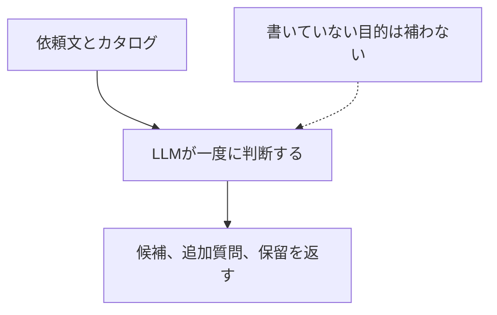
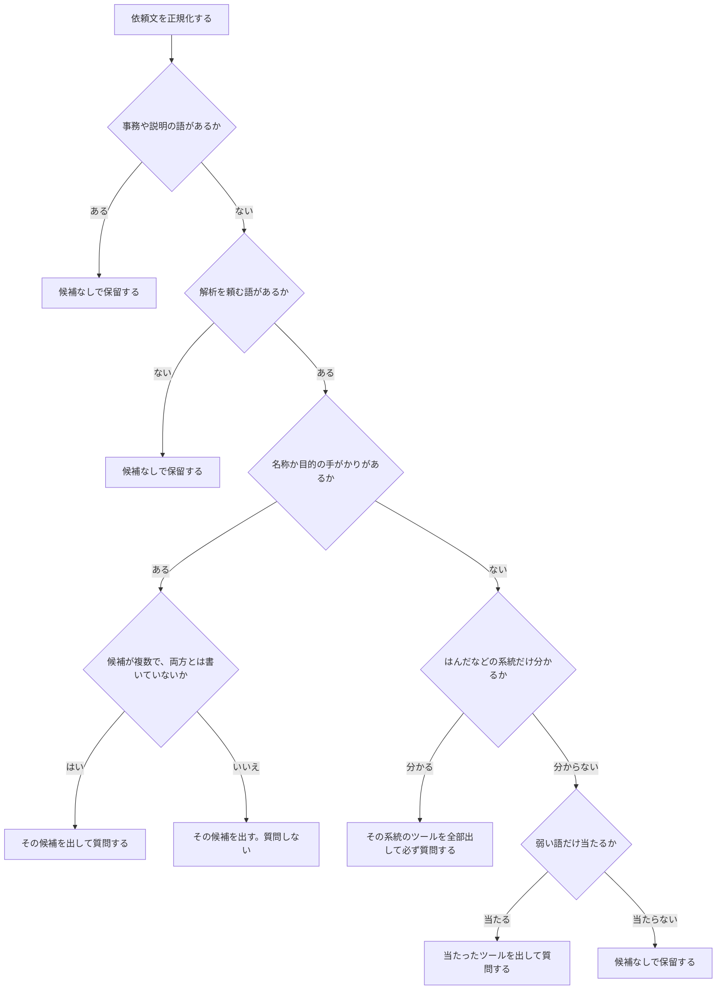
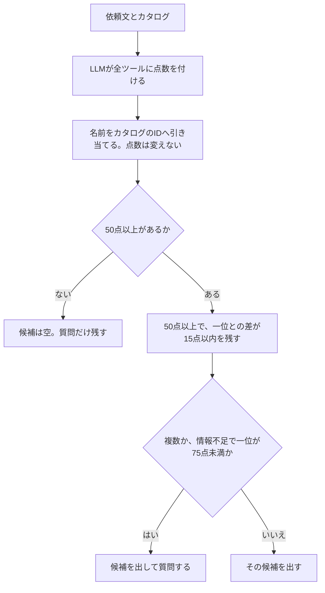
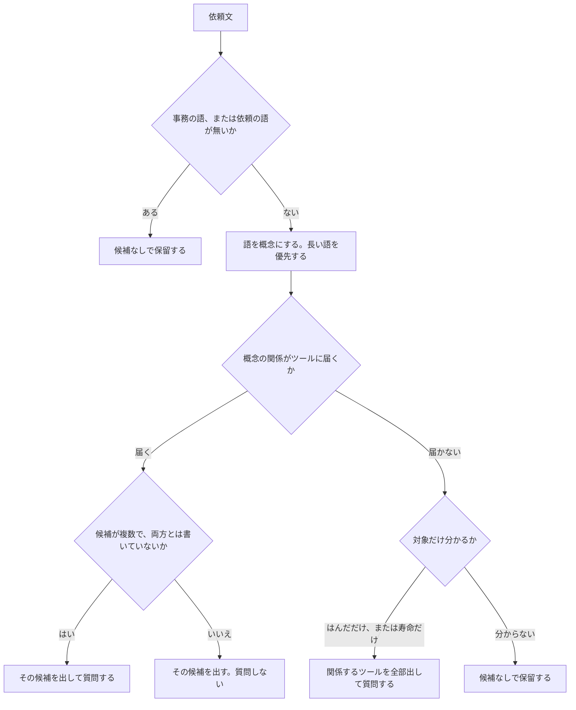

# ツール選択方式の比較レポート

## 結論

最もよかったのは同率1位の **D1（オントロジー）**、**D2（オントロジー＋LLM・Sol）**、**D3（オントロジー＋LLM・Terra）** である。候補集合の F1 は 1.000 で、不要な質問、一つに決めた割合、追加質問の妥当も同じである。

順位は候補集合の F1 だけでは決めない。F1 が同じときは、不要な質問が少ない方、一つに決めた割合が低い方、追加質問が妥当な方、の順で分ける。ここまで同じときだけ同率とする。候補集合の F1 が 0.85 以上を「良い」、0.80 以上 0.85 未満を「中間」、0.80 未満を「弱い」とした。この区切りは見やすさのためである。

| 順 | 条件 | 候補集合のF1 | 判定 | 不要な質問 | 一つに決めた | 追加質問の妥当 |
|---|---|---|---|---|---|---|
| 同率1位 | D1（オントロジー） | 1.000 | 良い | 0.0% | 0.0% | 100.0% |
| 同率1位 | D2（オントロジー＋LLM・Sol） | 1.000 | 良い | 0.0% | 0.0% | 100.0% |
| 同率1位 | D3（オントロジー＋LLM・Terra） | 1.000 | 良い | 0.0% | 0.0% | 100.0% |
| 4位 | A2（LLM選択・Terra） | 1.000 | 良い | 0.0% | 0.0% | 66.7% |
| 5位 | A1（LLM選択・Sol） | 0.991 | 良い | 0.0% | 11.1% | 61.1% |
| 6位 | D4（オントロジー＋LLM・Luna） | 0.972 | 良い | 5.6% | 0.0% | 100.0% |
| 7位 | B1（辞書・規則） | 0.944 | 良い | 38.9% | 0.0% | 100.0% |
| 8位 | C3（LLM採点＋しきい値（擬似jev）・Luna） | 0.806 | 中間 | 16.7% | 0.0% | 100.0% |
| 9位 | A3（LLM選択・Luna） | 0.796 | 弱い | 0.0% | 11.1% | 61.1% |
| 10位 | C2（LLM採点＋しきい値（擬似jev）・Terra） | 0.769 | 弱い | 16.7% | 0.0% | 100.0% |
| 11位 | C1（LLM採点＋しきい値（擬似jev）・Sol） | 0.769 | 弱い | 16.7% | 11.1% | 94.4% |

依頼の種類ごとの判定である。

| 条件 | 明確 | 表記ゆれ | 口語 | 曖昧 | 暗黙の前提 |
|---|---|---|---|---|---|
| D1（オントロジー） | 良い | 良い | 良い | 良い | 良い |
| D2（オントロジー＋LLM・Sol） | 良い | 良い | 良い | 良い | 良い |
| D3（オントロジー＋LLM・Terra） | 良い | 良い | 良い | 良い | 良い |
| A2（LLM選択・Terra） | 良い | 良い | 良い | 良い | 良い |
| A1（LLM選択・Sol） | 良い | 良い | 良い | 良い | 良い |
| D4（オントロジー＋LLM・Luna） | 良い | 良い | 良い | 良い | 弱い |
| B1（辞書・規則） | 良い | 良い | 良い | 良い | 良い |
| C3（LLM採点＋しきい値（擬似jev）・Luna） | 良い | 弱い | 弱い | 弱い | 良い |
| A3（LLM選択・Luna） | 良い | 弱い | 弱い | 弱い | 良い |
| C2（LLM採点＋しきい値（擬似jev）・Terra） | 良い | 弱い | 弱い | 弱い | 弱い |
| C1（LLM採点＋しきい値（擬似jev）・Sol） | 良い | 弱い | 弱い | 弱い | 弱い |

| 条件 | 理由 |
|---|---|
| D1（オントロジー） | 36件すべてで候補が選ぶべきツールと一致した。関係は、正解を書いた人が辞書の外れ方を見てから書いている。 |
| D2（オントロジー＋LLM・Sol） | Sol の概念への当てはめは、オントロジーの関係が選ぶ候補と一致した。 |
| D3（オントロジー＋LLM・Terra） | Terra の概念への当てはめは、オントロジーの関係が選ぶ候補と一致した。 |
| A2（LLM選択・Terra） | 候補は36件すべて選ぶべきツールと一致した。カタログ外とキーワードの依頼では保留したが、質問文が空だった。 |
| A1（LLM選択・Sol） | 「冷熱を繰り返すとはんだが持たない」で、はんだ寿命予測だけを質問なしで出した。 |
| D4（オントロジー＋LLM・Luna） | 「鋼が繰り返しで折れそうなので寿命を見たい」で、寿命を概念にせず示唆に入れた。候補は空になった。 |
| B1（辞書・規則） | 目的の文字列からずれると、亀裂進展と寿命予測を両方出して必ず質問する。 |
| C3（LLM採点＋しきい値（擬似jev）・Luna） | 50点未満は候補から外す。暗黙の前提では両はんだツールを残せた。 |
| A3（LLM選択・Luna） | 半田、ハンダ、ソルダだけ、寿命だけ、のように目的が未定だと候補を空にする。 |
| C2（LLM採点＋しきい値（擬似jev）・Terra） | 半田やハンダのシミュレーションは両ツールが50点未満。025は寿命予測だけを出して質問した。 |
| C1（LLM採点＋しきい値（擬似jev）・Sol） | 半田やハンダのシミュレーションは両ツールが50点未満。025は寿命予測だけを質問なしで出した。 |

## 実行条件

- 実行日時: 2026-10-15
- テスト件数: 36
- 主カテゴリ内訳: 明確（目的が書いてある） 6件、表記ゆれ 7件、口語・俗称・略語 4件、複数ツールを明示 3件、曖昧（対象だけで目的が未定） 4件、暗黙の前提 3件、情報不足 3件、表層キーワードの引っかけ 3件、カタログ外 3件
- 正解ラベル: 実装者1名が、モデル出力を見る前に付与した。複数人の独立ラベルと不一致解消は行っていない。
- 条件番号は方式ごとの連番で、モデルは Sol、Terra、Luna の順に付ける。
- モデルID: Sol `gpt-5.6-sol-medium`、Terra `gpt-5.6-terra-medium`、Luna `gpt-5.6-luna-medium`。推論設定はモデルIDの medium。温度は指定できない。
- グラフは LangGraph。解析ツールの実行機能は評価グラフに繋いでいない。

## 比較条件

番号は方式ごとの連番である。同じ番号でも方式が違えば別条件である。A1（LLM選択・Sol）と C1（LLM採点＋しきい値（擬似jev）・Sol）は、どちらも Sol だが別の実験である。

- LLM選択: LLM がカタログと依頼文を読み、候補、追加質問、保留を一度に返す。書いていない目的は補わない。
- 辞書・規則: LLM を使わない。カタログの名称、目的の手がかり、系統、事務・説明表現の除外で候補を決める。どの規則が当たったかを残す。得点は付けない。
- LLM採点＋しきい値（擬似jev）: LLM がカタログの全ツールに適合度を付ける。別処理がツール ID をカタログから引き、得点の高さと差で、候補を出すか追加質問するかを決める。適合度は校正済みの確率ではない。
- オントロジー: 語を概念にまとめ、関係でツールへ結ぶ。D1 は LLM を使わない。D2、D3、D4 は LLM が概念へ当てはめ、候補は同じ関係が決める。割れ、持たない、折れは示唆で、目的を一つに決めない。

### LLM選択

A1、A2、A3 はこの流れである。モデルだけが違う。

### 辞書・規則

B1 はこの流れである。LLM は使わない。当たった規則は記録する。得点は付けない。

名称か目的の手がかりがあるときは、系統へは広げない。短い目的の語が、別ツールの長い語の一部なら、短い方は捨てる。

### LLM採点＋しきい値（擬似jev）

C1、C2、C3 はこの流れである。点数を付けるモデルだけが違う。点数は確率ではない。

### オントロジー

D1 は LLM を使わない。D2、D3、D4 は LLM が依頼文を概念へ当てはめ、そのあとで同じ関係が候補を決める。

割れ、持たない、折れは示唆である。概念には足さず、目的を一つに決めない。LLMありのときは、上の読み取りだけを LLM が行う。そのあとの関係は D1 と同じである。

D1 の読み取りで、依頼がどう分かれるかの例である。

| 依頼 | 立った概念 | 示唆 | 判断 | 候補 |
|---|---|---|---|---|
| 半田のき裂がどこまで進むかシミュレーションしたい | はんだ、亀裂、進展 | なし | はんだと亀裂がそろった | はんだ亀裂進展シミュレーション。質問しない |
| 半田接合の熱疲労寿命を計算したい | はんだ、熱疲労、寿命 | なし | 熱疲労は疲労より長いので、疲労は立たない。はんだと寿命がそろった | はんだ寿命予測シミュレーション。質問しない |
| 半田のシミュレーションをしたい | はんだ | なし | 対象だけで、目的の概念が無い | はんだ亀裂進展シミュレーションとはんだ寿命予測シミュレーションを出して質問する |
| はんだが割れそうなので見たい | はんだ | 亀裂（割れ） | 割れは亀裂の確定にしない | はんだ亀裂進展シミュレーションとはんだ寿命予測シミュレーションを出して質問する |
| 冷熱を繰り返すとはんだが持たない気がするので見たい | はんだ | 寿命（持たない） | 持たないは寿命の確定にしない | はんだ亀裂進展シミュレーションとはんだ寿命予測シミュレーションを出して質問する |
| 温度サイクルの寿命と、亀裂がどう伸びるかの両方をはんだで見たい | はんだ、寿命、亀裂 | なし | 二つの関係に届き、両方と書いてある | はんだ亀裂進展シミュレーションとはんだ寿命予測シミュレーションを出す。質問しない |
| 鋼が繰り返しで折れそうなので寿命を見たい | 金属、寿命 | なし | 寿命の語があるので、折れは示唆に残さない。金属と寿命がそろった | 疲労寿命予測。質問しない |
| はんだの成分を化学分析したい | はんだ | なし | 化学分析は解析の実行ではない | 候補なしで保留する |
| ブラケットの固有振動数を計算したい | なし | なし | 計算とはあるが、概念がツールまで届かない | 候補なしで保留する |

D4（オントロジー＋LLM・Luna）は、「鋼が繰り返しで折れそうなので寿命を見たい」で寿命を概念にせず示唆へ入れた。金属だけでは疲労寿命予測に届かず、候補は空になった。

| 条件 | 方式 | モデル | この条件でやること |
|---|---|---|---|
| A1（LLM選択・Sol） | LLM選択 | Sol | Sol が共有カタログを読み、候補・追加質問・保留を直接返す。複数候補を返してよい。 |
| A2（LLM選択・Terra） | LLM選択 | Terra | Terra が共有カタログを読み、候補・追加質問・保留を直接返す。複数候補を返してよい。 |
| A3（LLM選択・Luna） | LLM選択 | Luna | Luna が共有カタログを読み、候補・追加質問・保留を直接返す。複数候補を返してよい。 |
| B1（辞書・規則） | 辞書・規則 | なし | モデルは使わない。名称、目的の手がかり、系統、事務・説明表現の除外で候補を決める。得点は付けない。 |
| C1（LLM採点＋しきい値（擬似jev）・Sol） | LLM採点＋しきい値（擬似jev） | Sol | Sol が全ツールに適合度を付ける。別処理が ID をカタログで引き、得点の高さと差で候補を出すか質問するかを決める。適合度は確率ではない。 |
| C2（LLM採点＋しきい値（擬似jev）・Terra） | LLM採点＋しきい値（擬似jev） | Terra | Terra が全ツールに適合度を付ける。別処理が ID をカタログで引き、得点の高さと差で候補を出すか質問するかを決める。適合度は確率ではない。 |
| C3（LLM採点＋しきい値（擬似jev）・Luna） | LLM採点＋しきい値（擬似jev） | Luna | Luna が全ツールに適合度を付ける。別処理が ID をカタログで引き、得点の高さと差で候補を出すか質問するかを決める。適合度は確率ではない。 |
| D1（オントロジー） | オントロジー | なし | モデルは使わない。語を概念にまとめ、関係でツールへ結ぶ。割れや持たないは示唆で、目的を一つに決めない。 |
| D2（オントロジー＋LLM・Sol） | オントロジー＋LLM | Sol | Sol が依頼文を概念へ当てはめる。ツールの決定はオントロジーの関係が行う。 |
| D3（オントロジー＋LLM・Terra） | オントロジー＋LLM | Terra | Terra が依頼文を概念へ当てはめる。ツールの決定はオントロジーの関係が行う。 |
| D4（オントロジー＋LLM・Luna） | オントロジー＋LLM | Luna | Luna が依頼文を概念へ当てはめる。ツールの決定はオントロジーの関係が行う。 |

## 評価指標

候補の正解は一つのツールに限らない。選ぶべきツールに入っていればそのツールは正解で、必須は必ず含めなければならない。質問すべきか、保留すべきかもラベルに含まれ、ユーザーが後から選んだ結果は精度に入れていない。

### 候補集合のF1

出したツールの集合が、選ぶべきツールにどれだけ近いかを、依頼1件ごとに 0 から 1 で表した値である。表の数字は、その値を対象の依頼で平均したものである。全件の平均が総合の F1、種類ごとの平均がカテゴリ別の F1 である。

1件の計算は、次の二つを組み合わせる。

- 適合率は、出したツールのうち選ぶべきツールに入っていた割合である。余分なツールを足すと下がる。
- 再現率は、選ぶべきツールのうち出せていた割合である。出すべきツールを落とすと下がる。
- F1 は 2 × 適合率 × 再現率 ÷（適合率 + 再現率）である。どちらかが低いと、もう一方が高くても F1 は伸びない。

例は次のとおりである。

- 選ぶべきツールが疲労寿命予測だけで、それだけ出した。F1 は 1。
- 選ぶべきツールがはんだ亀裂進展とはんだ寿命予測の2件で、1件だけ出した。適合率は 1、再現率は 0.5、F1 は 0.667。
- 選ぶべきツールが1件で、その1件に加えて別のツールも出した。適合率は 0.5、再現率は 1、F1 は 0.667。
- 選ぶべきツールがあるのに候補が空、または選ぶべきツールが無いのに候補を出した。F1 は 0。
- 選ぶべきツールも候補も無い。出さないのが正解で出していないので、F1 は 1。

F1 が見ているのはツールの集合だけである。質問の有無は、下の表の「追加質問の妥当」と「不要な質問」で集計する。

| 指標 | 意味 | 読み方 |
|---|---|---|
| 候補集合のF1 | 上の計算を依頼ごとに行い、平均する。1 に近いほど、出してよいツールに近い。 | 1 なら過不足なく一致。0.667 は、2件中1件だけ出すか、正解1件に余分を1件足した程度。 |
| 完全一致 | 出した候補が選ぶべきツールとまったく同じだった割合。 | 高いほど、過不足なく一致している。 |
| 必須の包含 | 必須ツールがすべて予測に入っていた割合。必須が空のケースは分母に入らない。 | 高いほど、落としてはいけないツールを残せている。 |
| 単一正解 | 正解が1ツールのケースで、その1件だけを選べた割合。 | 高いほど、目的が一つの依頼を選べている。 |
| 複数候補の妥当 | 複数候補が期待されるケースで、必須を含み、選ぶべきツールの範囲に収まり、2件以上出している割合。 | 高いほど、迷う依頼で候補を狭めすぎていない。 |
| 追加質問の妥当 | 質問すべきケースで、質問すると判断し、質問文もある割合。 | 高いほど、確認が必要な依頼で質問できている。 |
| 不要な質問 | 質問しなくてよいケースで、それでも質問した割合。 | 低いほど、明確な依頼を止めずに進める。 |
| 一つに決めた | 複数候補を残して質問すべきケースで、質問せず1件に決めた割合。 | 低いほど、書いていない目的で絞り込みすぎていない。 |
| 対象外の保留 | カタログ外、または適用が不明なケースで、候補を出さず保留した割合。 | 高いほど、カタログに無い依頼をツールに寄せていない。 |
| 処理エラー | 応答を候補に変換できなかった割合。選択の良し悪しではない。 | 0 なら、集計に乗らなかった応答はない。 |

カテゴリ別の値も同じ候補集合の F1 である。1件の依頼が複数カテゴリに入ることがある。誤り分類は規則による自動付与で、1件に複数の誤りが付く。人手で読み直した分類ではない。

## 結果の一覧

候補集合の F1 が 0.85 以上を「良い」、0.80 以上 0.85 未満を「中間」、0.80 未満を「弱い」とした。この区切りは一覧を見やすくするためのものである。

| 順 | 条件 | 方式 | モデル | 候補集合のF1 | 判定 | 曖昧 | 暗黙の前提 | 明確 |
|---|---|---|---|---|---|---|---|---|
| 同率1位 | D1（オントロジー） | オントロジー | なし | 1.000 | 良い | 1.000（良い） | 1.000（良い） | 1.000（良い） |
| 同率1位 | D2（オントロジー＋LLM・Sol） | オントロジー＋LLM | Sol | 1.000 | 良い | 1.000（良い） | 1.000（良い） | 1.000（良い） |
| 同率1位 | D3（オントロジー＋LLM・Terra） | オントロジー＋LLM | Terra | 1.000 | 良い | 1.000（良い） | 1.000（良い） | 1.000（良い） |
| 4位 | A2（LLM選択・Terra） | LLM選択 | Terra | 1.000 | 良い | 1.000（良い） | 1.000（良い） | 1.000（良い） |
| 5位 | A1（LLM選択・Sol） | LLM選択 | Sol | 0.991 | 良い | 0.963（良い） | 0.889（良い） | 1.000（良い） |
| 6位 | D4（オントロジー＋LLM・Luna） | オントロジー＋LLM | Luna | 0.972 | 良い | 1.000（良い） | 0.667（弱い） | 0.944（良い） |
| 7位 | B1（辞書・規則） | 辞書・規則 | なし | 0.944 | 良い | 1.000（良い） | 0.889（良い） | 0.889（良い） |
| 8位 | C3（LLM採点＋しきい値（擬似jev）・Luna） | LLM採点＋しきい値（擬似jev） | Luna | 0.806 | 中間 | 0.222（弱い） | 1.000（良い） | 1.000（良い） |
| 9位 | A3（LLM選択・Luna） | LLM選択 | Luna | 0.796 | 弱い | 0.185（弱い） | 0.889（良い） | 1.000（良い） |
| 10位 | C2（LLM採点＋しきい値（擬似jev）・Terra） | LLM採点＋しきい値（擬似jev） | Terra | 0.769 | 弱い | 0.074（弱い） | 0.556（弱い） | 1.000（良い） |
| 11位 | C1（LLM採点＋しきい値（擬似jev）・Sol） | LLM採点＋しきい値（擬似jev） | Sol | 0.769 | 弱い | 0.074（弱い） | 0.556（弱い） | 1.000（良い） |

不要な質問と、一つに決めた割合は、低い方が望ましい。

| 条件 | 方式 | モデル | 不要な質問 | 一つに決めた | 候補漏れ |
|---|---|---|---|---|---|
| D1（オントロジー） | オントロジー | なし | 0.0% | 0.0% | 0 |
| D2（オントロジー＋LLM・Sol） | オントロジー＋LLM | Sol | 0.0% | 0.0% | 0 |
| D3（オントロジー＋LLM・Terra） | オントロジー＋LLM | Terra | 0.0% | 0.0% | 0 |
| A2（LLM選択・Terra） | LLM選択 | Terra | 0.0% | 0.0% | 0 |
| A1（LLM選択・Sol） | LLM選択 | Sol | 0.0% | 11.1% | 1 |
| D4（オントロジー＋LLM・Luna） | オントロジー＋LLM | Luna | 5.6% | 0.0% | 1 |
| B1（辞書・規則） | 辞書・規則 | なし | 38.9% | 0.0% | 0 |
| C3（LLM採点＋しきい値（擬似jev）・Luna） | LLM採点＋しきい値（擬似jev） | Luna | 16.7% | 0.0% | 7 |
| A3（LLM選択・Luna） | LLM選択 | Luna | 0.0% | 11.1% | 8 |
| C2（LLM採点＋しきい値（擬似jev）・Terra） | LLM採点＋しきい値（擬似jev） | Terra | 16.7% | 0.0% | 9 |
| C1（LLM採点＋しきい値（擬似jev）・Sol） | LLM採点＋しきい値（擬似jev） | Sol | 16.7% | 11.1% | 9 |

## 総合比較

| 条件 | 方式 | モデル | 実行 | 候補集合のF1 | 完全一致 | 必須の包含 | 単一正解 | 複数候補の妥当 | 追加質問の妥当 | 不要な質問 | 一つに決めた | 対象外の保留 | 処理エラー |
|---|---|---|---|---|---|---|---|---|---|---|---|---|---|
| A1（LLM選択・Sol） | LLM選択 | Sol | 実行済み | 0.991 | 97.2% | 96.3% | 100.0% | 91.7% | 61.1% | 0.0% | 11.1% | 100.0% | 0.0% |
| A2（LLM選択・Terra） | LLM選択 | Terra | 実行済み | 1.000 | 100.0% | 100.0% | 100.0% | 100.0% | 66.7% | 0.0% | 0.0% | 100.0% | 0.0% |
| A3（LLM選択・Luna） | LLM選択 | Luna | 実行済み | 0.796 | 77.8% | 70.4% | 100.0% | 33.3% | 61.1% | 0.0% | 11.1% | 100.0% | 0.0% |
| B1（辞書・規則） | 辞書・規則 | なし | 実行済み | 0.944 | 83.3% | 100.0% | 60.0% | 100.0% | 100.0% | 38.9% | 0.0% | 100.0% | 0.0% |
| C1（LLM採点＋しきい値（擬似jev）・Sol） | LLM採点＋しきい値（擬似jev） | Sol | 実行済み | 0.769 | 75.0% | 66.7% | 100.0% | 25.0% | 94.4% | 16.7% | 11.1% | 100.0% | 0.0% |
| C2（LLM採点＋しきい値（擬似jev）・Terra） | LLM採点＋しきい値（擬似jev） | Terra | 実行済み | 0.769 | 75.0% | 66.7% | 100.0% | 25.0% | 100.0% | 16.7% | 0.0% | 100.0% | 0.0% |
| C3（LLM採点＋しきい値（擬似jev）・Luna） | LLM採点＋しきい値（擬似jev） | Luna | 実行済み | 0.806 | 80.6% | 74.1% | 100.0% | 41.7% | 100.0% | 16.7% | 0.0% | 100.0% | 0.0% |
| D1（オントロジー） | オントロジー | なし | 実行済み | 1.000 | 100.0% | 100.0% | 100.0% | 100.0% | 100.0% | 0.0% | 0.0% | 100.0% | 0.0% |
| D2（オントロジー＋LLM・Sol） | オントロジー＋LLM | Sol | 実行済み | 1.000 | 100.0% | 100.0% | 100.0% | 100.0% | 100.0% | 0.0% | 0.0% | 100.0% | 0.0% |
| D3（オントロジー＋LLM・Terra） | オントロジー＋LLM | Terra | 実行済み | 1.000 | 100.0% | 100.0% | 100.0% | 100.0% | 100.0% | 0.0% | 0.0% | 100.0% | 0.0% |
| D4（オントロジー＋LLM・Luna） | オントロジー＋LLM | Luna | 実行済み | 0.972 | 97.2% | 96.3% | 93.3% | 100.0% | 100.0% | 5.6% | 0.0% | 100.0% | 0.0% |

## カテゴリ別の候補集合F1

列名は条件番号、方式、モデルである。

| 依頼の種類 | A1（LLM選択・Sol） | A2（LLM選択・Terra） | A3（LLM選択・Luna） | B1（辞書・規則） | C1（LLM採点＋しきい値（擬似jev）・Sol） | C2（LLM採点＋しきい値（擬似jev）・Terra） | C3（LLM採点＋しきい値（擬似jev）・Luna） | D1（オントロジー） | D2（オントロジー＋LLM・Sol） | D3（オントロジー＋LLM・Terra） | D4（オントロジー＋LLM・Luna） |
|---|---|---|---|---|---|---|---|---|---|---|---|
| 明確（目的が書いてある） | 1.000 | 1.000 | 1.000 | 0.889 | 1.000 | 1.000 | 1.000 | 1.000 | 1.000 | 1.000 | 0.944 |
| 表記ゆれ | 1.000 | 1.000 | 0.714 | 0.905 | 0.714 | 0.714 | 0.714 | 1.000 | 1.000 | 1.000 | 1.000 |
| 口語・俗称・略語 | 1.000 | 1.000 | 0.750 | 0.917 | 0.750 | 0.750 | 0.750 | 1.000 | 1.000 | 1.000 | 1.000 |
| 複数ツールを明示 | 1.000 | 1.000 | 1.000 | 1.000 | 1.000 | 1.000 | 1.000 | 1.000 | 1.000 | 1.000 | 1.000 |
| 曖昧（対象だけで目的が未定） | 0.963 | 1.000 | 0.185 | 1.000 | 0.074 | 0.074 | 0.222 | 1.000 | 1.000 | 1.000 | 1.000 |
| 暗黙の前提 | 0.889 | 1.000 | 0.889 | 0.889 | 0.556 | 0.556 | 1.000 | 1.000 | 1.000 | 1.000 | 0.667 |
| 情報不足 | 1.000 | 1.000 | 1.000 | 1.000 | 1.000 | 1.000 | 1.000 | 1.000 | 1.000 | 1.000 | 1.000 |
| 表層キーワードの引っかけ | 1.000 | 1.000 | 1.000 | 1.000 | 1.000 | 1.000 | 1.000 | 1.000 | 1.000 | 1.000 | 1.000 |
| カタログ外 | 1.000 | 1.000 | 1.000 | 1.000 | 1.000 | 1.000 | 1.000 | 1.000 | 1.000 | 1.000 | 1.000 |

## 誤り分類

件数は自動規則で数えた。1件に複数の誤りが付くことがある。

| 誤り | 意味 |
|---|---|
| 過剰な意図補完 | 書いていない目的を補って、候補を一つに絞った。 |
| 表層キーワード誤選択 | 引っかけ用の語に釣られて、カタログ外なのに候補を出した。 |
| 候補漏れ | 出すべきツールが候補に入っていない。質問だけして候補が空の場合も含む。 |
| 過剰選択 | 選ぶべきでないツールを多く足した。 |
| 不適切な追加質問 | 質問しなくてよい依頼なのに質問した。 |
| 質問不足 | 質問すべき依頼なのに質問しなかった。 |
| カタログ照合ミス | カタログに無い ID を返した。 |
| その他 | 上の規則に当てはまらない不一致。 |

| 誤り | A1（LLM選択・Sol） | A2（LLM選択・Terra） | A3（LLM選択・Luna） | B1（辞書・規則） | C1（LLM採点＋しきい値（擬似jev）・Sol） | C2（LLM採点＋しきい値（擬似jev）・Terra） | C3（LLM採点＋しきい値（擬似jev）・Luna） | D1（オントロジー） | D2（オントロジー＋LLM・Sol） | D3（オントロジー＋LLM・Terra） | D4（オントロジー＋LLM・Luna） |
|---|---|---|---|---|---|---|---|---|---|---|---|
| 過剰な意図補完 | 1 | 0 | 1 | 0 | 1 | 0 | 0 | 0 | 0 | 0 | 0 |
| 表層キーワード誤選択 | 0 | 0 | 0 | 0 | 0 | 0 | 0 | 0 | 0 | 0 | 0 |
| 候補漏れ | 1 | 0 | 8 | 0 | 9 | 9 | 7 | 0 | 0 | 0 | 1 |
| 過剰選択 | 0 | 0 | 0 | 0 | 0 | 0 | 0 | 0 | 0 | 0 | 0 |
| 不適切な追加質問 | 0 | 0 | 0 | 7 | 3 | 3 | 3 | 0 | 0 | 0 | 1 |
| 質問不足 | 1 | 0 | 1 | 0 | 1 | 0 | 0 | 0 | 0 | 0 | 0 |
| カタログ照合ミス | 0 | 0 | 0 | 0 | 0 | 0 | 0 | 0 | 0 | 0 | 0 |
| その他 | 0 | 0 | 0 | 0 | 0 | 0 | 0 | 0 | 0 | 0 | 0 |

## 安定性

複数回実行の結果は、このレポート生成時点では未実施。

## 制約

- 温度は指定できない。推論設定はモデルIDに含まれる medium のみ。
- 正解ラベルは実装者1名で、複数人の独立ラベルではない。
- オントロジーの関係は、正解ラベルを書いた実装者1名が、辞書の外れ方を見てから書いた。モデル出力を見て関係を直してはいない。
- 誤り分類は規則による自動分類で、人手の再判定ではない。
- ユーザー確認後の選択は方式の精度に含めていない。
- 同一入力の繰り返し実行は未実施。

## 事例

見出しは条件番号、方式、モデルである。選ぶべきツールは、その依頼で出すのが正解のツールである。予測はその条件が出した候補である。

### A1（LLM選択・Sol）

#### 過剰な意図補完

- 025「冷熱を繰り返すとはんだが持たない気がするので見たい」 選ぶべきツール: はんだ亀裂進展シミュレーション、はんだ寿命予測シミュレーション。予測: はんだ寿命予測シミュレーション。質問なし

#### 表層キーワード誤選択

該当なし。

#### 候補漏れ

- 025「冷熱を繰り返すとはんだが持たない気がするので見たい」 選ぶべきツール: はんだ亀裂進展シミュレーション、はんだ寿命予測シミュレーション。予測: はんだ寿命予測シミュレーション。質問なし

### A2（LLM選択・Terra）

#### 過剰な意図補完

該当なし。

#### 表層キーワード誤選択

該当なし。

#### 候補漏れ

該当なし。

### A3（LLM選択・Luna）

#### 過剰な意図補完

- 025「冷熱を繰り返すとはんだが持たない気がするので見たい」 選ぶべきツール: はんだ亀裂進展シミュレーション、はんだ寿命予測シミュレーション。予測: はんだ寿命予測シミュレーション。質問なし

#### 表層キーワード誤選択

該当なし。

#### 候補漏れ

- 007「半田のシミュレーションをしたい」 選ぶべきツール: はんだ亀裂進展シミュレーション、はんだ寿命予測シミュレーション。予測: なし。質問あり
- 008「ハンダのシミュレーションをしたい」 選ぶべきツール: はんだ亀裂進展シミュレーション、はんだ寿命予測シミュレーション。予測: なし。質問あり
- 013「ソルダの解析をお願いします」 選ぶべきツール: はんだ亀裂進展シミュレーション、はんだ寿命予測シミュレーション。予測: なし。質問あり

### B1（辞書・規則）

#### 過剰な意図補完

該当なし。

#### 表層キーワード誤選択

該当なし。

#### 候補漏れ

該当なし。

### C1（LLM採点＋しきい値（擬似jev）・Sol）

#### 過剰な意図補完

- 025「冷熱を繰り返すとはんだが持たない気がするので見たい」 選ぶべきツール: はんだ亀裂進展シミュレーション、はんだ寿命予測シミュレーション。予測: はんだ寿命予測シミュレーション。質問なし

#### 表層キーワード誤選択

該当なし。

#### 候補漏れ

- 007「半田のシミュレーションをしたい」 選ぶべきツール: はんだ亀裂進展シミュレーション、はんだ寿命予測シミュレーション。予測: なし。質問あり
- 008「ハンダのシミュレーションをしたい」 選ぶべきツール: はんだ亀裂進展シミュレーション、はんだ寿命予測シミュレーション。予測: なし。質問あり
- 013「ソルダの解析をお願いします」 選ぶべきツール: はんだ亀裂進展シミュレーション、はんだ寿命予測シミュレーション。予測: なし。質問あり

### C2（LLM採点＋しきい値（擬似jev）・Terra）

#### 過剰な意図補完

該当なし。

#### 表層キーワード誤選択

該当なし。

#### 候補漏れ

- 007「半田のシミュレーションをしたい」 選ぶべきツール: はんだ亀裂進展シミュレーション、はんだ寿命予測シミュレーション。予測: なし。質問あり
- 008「ハンダのシミュレーションをしたい」 選ぶべきツール: はんだ亀裂進展シミュレーション、はんだ寿命予測シミュレーション。予測: なし。質問あり
- 013「ソルダの解析をお願いします」 選ぶべきツール: はんだ亀裂進展シミュレーション、はんだ寿命予測シミュレーション。予測: なし。質問あり

### C3（LLM採点＋しきい値（擬似jev）・Luna）

#### 過剰な意図補完

該当なし。

#### 表層キーワード誤選択

該当なし。

#### 候補漏れ

- 007「半田のシミュレーションをしたい」 選ぶべきツール: はんだ亀裂進展シミュレーション、はんだ寿命予測シミュレーション。予測: なし。質問あり
- 008「ハンダのシミュレーションをしたい」 選ぶべきツール: はんだ亀裂進展シミュレーション、はんだ寿命予測シミュレーション。予測: なし。質問あり
- 013「ソルダの解析をお願いします」 選ぶべきツール: はんだ亀裂進展シミュレーション、はんだ寿命予測シミュレーション。予測: なし。質問あり

### D1（オントロジー）

#### 過剰な意図補完

該当なし。

#### 表層キーワード誤選択

該当なし。

#### 候補漏れ

該当なし。

### D2（オントロジー＋LLM・Sol）

#### 過剰な意図補完

該当なし。

#### 表層キーワード誤選択

該当なし。

#### 候補漏れ

該当なし。

### D3（オントロジー＋LLM・Terra）

#### 過剰な意図補完

該当なし。

#### 表層キーワード誤選択

該当なし。

#### 候補漏れ

該当なし。

### D4（オントロジー＋LLM・Luna）

#### 過剰な意図補完

該当なし。

#### 表層キーワード誤選択

該当なし。

#### 候補漏れ

- 026「鋼が繰り返しで折れそうなので寿命を見たい」 選ぶべきツール: 疲労寿命予測。予測: なし。質問あり

## 同じ依頼での比較

上の事例に出た依頼について、11条件が何を候補にし、質問したかを並べた。判断は、選ぶべきツールと質問の有無を正解と比べた自動分類である。

適合度はLLM採点＋しきい値（擬似jev）が各ツールに付けた得点である。LLM選択と辞書・規則は得点を付けない。20以上を高い順に書き、どれも20未満のときは最高点だけを書いた。同点が4件以上なら最高点の数値だけにした。0は省いた。候補に入れる下限は50、一位との差が15以内を接近とみなす。情報不足でも、一位が75以上ならその理由だけでは質問しない。

### 007　半田のシミュレーションをしたい

選ぶべきツール: はんだ亀裂進展シミュレーション、はんだ寿命予測シミュレーション。質問の正解: する。

| 条件 | 出した候補 | 適合度 | 質問 | 判断 |
|---|---|---|---|---|
| A1（LLM選択・Sol） | はんだ亀裂進展シミュレーション、はんだ寿命予測シミュレーション | — | あり。半田の亀裂の進み方と寿命サイクル数のどちらを求めますか？ | 選ぶべきツールと一致 |
| A2（LLM選択・Terra） | はんだ亀裂進展シミュレーション、はんだ寿命予測シミュレーション | — | あり。はんだ接合の亀裂進展と寿命回数のどちらを見たいですか？ | 選ぶべきツールと一致 |
| A3（LLM選択・Luna） | なし | — | あり。はんだについて、寿命回数と亀裂進展のどちらを調べたいですか？ | 候補漏れ |
| B1（辞書・規則） | はんだ亀裂進展シミュレーション、はんだ寿命予測シミュレーション | — | あり。次のどれが目的に近いですか。はんだ亀裂進展シミュレーション、はんだ寿命予測シミュレーション | 選ぶべきツールと一致 |
| C1（LLM採点＋しきい値（擬似jev）・Sol） | なし | はんだ亀裂進展シミュレーション 35、はんだ寿命予測シミュレーション 35 | あり。適合度がどれも低いです。解析の対象と、何を知りたいかを教えてください。 | 候補漏れ |
| C2（LLM採点＋しきい値（擬似jev）・Terra） | なし | はんだ亀裂進展シミュレーション 45、はんだ寿命予測シミュレーション 45 | あり。適合度がどれも低いです。解析の対象と、何を知りたいかを教えてください。 | 候補漏れ |
| C3（LLM採点＋しきい値（擬似jev）・Luna） | なし | はんだ亀裂進展シミュレーション 25、はんだ寿命予測シミュレーション 25 | あり。適合度がどれも低いです。解析の対象と、何を知りたいかを教えてください。 | 候補漏れ |
| D1（オントロジー） | はんだ亀裂進展シミュレーション、はんだ寿命予測シミュレーション | — | あり。次のどれが目的に近いですか。はんだ亀裂進展シミュレーション、はんだ寿命予測シミュレーション | 選ぶべきツールと一致 |
| D2（オントロジー＋LLM・Sol） | はんだ亀裂進展シミュレーション、はんだ寿命予測シミュレーション | — | あり。次のどれが目的に近いですか。はんだ亀裂進展シミュレーション、はんだ寿命予測シミュレーション | 選ぶべきツールと一致 |
| D3（オントロジー＋LLM・Terra） | はんだ亀裂進展シミュレーション、はんだ寿命予測シミュレーション | — | あり。次のどれが目的に近いですか。はんだ亀裂進展シミュレーション、はんだ寿命予測シミュレーション | 選ぶべきツールと一致 |
| D4（オントロジー＋LLM・Luna） | はんだ亀裂進展シミュレーション、はんだ寿命予測シミュレーション | — | あり。次のどれが目的に近いですか。はんだ亀裂進展シミュレーション、はんだ寿命予測シミュレーション | 選ぶべきツールと一致 |

### 008　ハンダのシミュレーションをしたい

選ぶべきツール: はんだ亀裂進展シミュレーション、はんだ寿命予測シミュレーション。質問の正解: する。

| 条件 | 出した候補 | 適合度 | 質問 | 判断 |
|---|---|---|---|---|
| A1（LLM選択・Sol） | はんだ亀裂進展シミュレーション、はんだ寿命予測シミュレーション | — | あり。ハンダの亀裂の進み方と寿命サイクル数のどちらを求めますか？ | 選ぶべきツールと一致 |
| A2（LLM選択・Terra） | はんだ亀裂進展シミュレーション、はんだ寿命予測シミュレーション | — | あり。ハンダ接合の亀裂進展と寿命回数のどちらを見たいですか？ | 選ぶべきツールと一致 |
| A3（LLM選択・Luna） | なし | — | あり。ハンダについて、寿命回数と亀裂進展のどちらを調べたいですか？ | 候補漏れ |
| B1（辞書・規則） | はんだ亀裂進展シミュレーション、はんだ寿命予測シミュレーション | — | あり。次のどれが目的に近いですか。はんだ亀裂進展シミュレーション、はんだ寿命予測シミュレーション | 選ぶべきツールと一致 |
| C1（LLM採点＋しきい値（擬似jev）・Sol） | なし | はんだ亀裂進展シミュレーション 35、はんだ寿命予測シミュレーション 35 | あり。適合度がどれも低いです。解析の対象と、何を知りたいかを教えてください。 | 候補漏れ |
| C2（LLM採点＋しきい値（擬似jev）・Terra） | なし | はんだ亀裂進展シミュレーション 45、はんだ寿命予測シミュレーション 45 | あり。適合度がどれも低いです。解析の対象と、何を知りたいかを教えてください。 | 候補漏れ |
| C3（LLM採点＋しきい値（擬似jev）・Luna） | なし | はんだ亀裂進展シミュレーション 25、はんだ寿命予測シミュレーション 25 | あり。適合度がどれも低いです。解析の対象と、何を知りたいかを教えてください。 | 候補漏れ |
| D1（オントロジー） | はんだ亀裂進展シミュレーション、はんだ寿命予測シミュレーション | — | あり。次のどれが目的に近いですか。はんだ亀裂進展シミュレーション、はんだ寿命予測シミュレーション | 選ぶべきツールと一致 |
| D2（オントロジー＋LLM・Sol） | はんだ亀裂進展シミュレーション、はんだ寿命予測シミュレーション | — | あり。次のどれが目的に近いですか。はんだ亀裂進展シミュレーション、はんだ寿命予測シミュレーション | 選ぶべきツールと一致 |
| D3（オントロジー＋LLM・Terra） | はんだ亀裂進展シミュレーション、はんだ寿命予測シミュレーション | — | あり。次のどれが目的に近いですか。はんだ亀裂進展シミュレーション、はんだ寿命予測シミュレーション | 選ぶべきツールと一致 |
| D4（オントロジー＋LLM・Luna） | はんだ亀裂進展シミュレーション、はんだ寿命予測シミュレーション | — | あり。次のどれが目的に近いですか。はんだ亀裂進展シミュレーション、はんだ寿命予測シミュレーション | 選ぶべきツールと一致 |

### 013　ソルダの解析をお願いします

選ぶべきツール: はんだ亀裂進展シミュレーション、はんだ寿命予測シミュレーション。質問の正解: する。

| 条件 | 出した候補 | 適合度 | 質問 | 判断 |
|---|---|---|---|---|
| A1（LLM選択・Sol） | はんだ亀裂進展シミュレーション、はんだ寿命予測シミュレーション | — | あり。ソルダの亀裂の進み方と寿命サイクル数のどちらを求めますか？ | 選ぶべきツールと一致 |
| A2（LLM選択・Terra） | はんだ亀裂進展シミュレーション、はんだ寿命予測シミュレーション | — | あり。ソルダ接合の亀裂進展と寿命回数のどちらを解析したいですか？ | 選ぶべきツールと一致 |
| A3（LLM選択・Luna） | なし | — | あり。ソルダについて、寿命予測と亀裂進展のどちらを解析したいですか？ | 候補漏れ |
| B1（辞書・規則） | はんだ亀裂進展シミュレーション、はんだ寿命予測シミュレーション | — | あり。次のどれが目的に近いですか。はんだ亀裂進展シミュレーション、はんだ寿命予測シミュレーション | 選ぶべきツールと一致 |
| C1（LLM採点＋しきい値（擬似jev）・Sol） | なし | はんだ亀裂進展シミュレーション 30、はんだ寿命予測シミュレーション 30 | あり。適合度がどれも低いです。解析の対象と、何を知りたいかを教えてください。 | 候補漏れ |
| C2（LLM採点＋しきい値（擬似jev）・Terra） | なし | はんだ亀裂進展シミュレーション 25、はんだ寿命予測シミュレーション 25 | あり。適合度がどれも低いです。解析の対象と、何を知りたいかを教えてください。 | 候補漏れ |
| C3（LLM採点＋しきい値（擬似jev）・Luna） | なし | はんだ亀裂進展シミュレーション 25、はんだ寿命予測シミュレーション 25 | あり。適合度がどれも低いです。解析の対象と、何を知りたいかを教えてください。 | 候補漏れ |
| D1（オントロジー） | はんだ亀裂進展シミュレーション、はんだ寿命予測シミュレーション | — | あり。次のどれが目的に近いですか。はんだ亀裂進展シミュレーション、はんだ寿命予測シミュレーション | 選ぶべきツールと一致 |
| D2（オントロジー＋LLM・Sol） | はんだ亀裂進展シミュレーション、はんだ寿命予測シミュレーション | — | あり。次のどれが目的に近いですか。はんだ亀裂進展シミュレーション、はんだ寿命予測シミュレーション | 選ぶべきツールと一致 |
| D3（オントロジー＋LLM・Terra） | はんだ亀裂進展シミュレーション、はんだ寿命予測シミュレーション | — | あり。次のどれが目的に近いですか。はんだ亀裂進展シミュレーション、はんだ寿命予測シミュレーション | 選ぶべきツールと一致 |
| D4（オントロジー＋LLM・Luna） | はんだ亀裂進展シミュレーション、はんだ寿命予測シミュレーション | — | あり。次のどれが目的に近いですか。はんだ亀裂進展シミュレーション、はんだ寿命予測シミュレーション | 選ぶべきツールと一致 |

### 025　冷熱を繰り返すとはんだが持たない気がするので見たい

選ぶべきツール: はんだ亀裂進展シミュレーション、はんだ寿命予測シミュレーション。質問の正解: する。

| 条件 | 出した候補 | 適合度 | 質問 | 判断 |
|---|---|---|---|---|
| A1（LLM選択・Sol） | はんだ寿命予測シミュレーション | — | なし | 過剰な意図補完、候補漏れ、質問不足 |
| A2（LLM選択・Terra） | はんだ寿命予測シミュレーション、はんだ亀裂進展シミュレーション | — | あり。冷熱の繰り返しに対して、はんだの寿命回数と亀裂進展のどちらを見たいですか？ | 選ぶべきツールと一致 |
| A3（LLM選択・Luna） | はんだ寿命予測シミュレーション | — | なし | 過剰な意図補完、候補漏れ、質問不足 |
| B1（辞書・規則） | はんだ亀裂進展シミュレーション、はんだ寿命予測シミュレーション | — | あり。次のどれが目的に近いですか。はんだ亀裂進展シミュレーション、はんだ寿命予測シミュレーション | 選ぶべきツールと一致 |
| C1（LLM採点＋しきい値（擬似jev）・Sol） | はんだ寿命予測シミュレーション | はんだ寿命予測シミュレーション 90 | なし | 過剰な意図補完、候補漏れ、質問不足 |
| C2（LLM採点＋しきい値（擬似jev）・Terra） | はんだ寿命予測シミュレーション | はんだ寿命予測シミュレーション 65、はんだ亀裂進展シミュレーション 35 | あり。次を教えてください。寿命回数か亀裂進展か、温度サイクル条件 | 候補漏れ |
| C3（LLM採点＋しきい値（擬似jev）・Luna） | はんだ亀裂進展シミュレーション、はんだ寿命予測シミュレーション | はんだ亀裂進展シミュレーション 50、はんだ寿命予測シミュレーション 50 | あり。次を教えてください。評価目的 | 選ぶべきツールと一致 |
| D1（オントロジー） | はんだ亀裂進展シミュレーション、はんだ寿命予測シミュレーション | — | あり。次のどれが目的に近いですか。はんだ亀裂進展シミュレーション、はんだ寿命予測シミュレーション | 選ぶべきツールと一致 |
| D2（オントロジー＋LLM・Sol） | はんだ亀裂進展シミュレーション、はんだ寿命予測シミュレーション | — | あり。次のどれが目的に近いですか。はんだ亀裂進展シミュレーション、はんだ寿命予測シミュレーション | 選ぶべきツールと一致 |
| D3（オントロジー＋LLM・Terra） | はんだ亀裂進展シミュレーション、はんだ寿命予測シミュレーション | — | あり。次のどれが目的に近いですか。はんだ亀裂進展シミュレーション、はんだ寿命予測シミュレーション | 選ぶべきツールと一致 |
| D4（オントロジー＋LLM・Luna） | はんだ亀裂進展シミュレーション、はんだ寿命予測シミュレーション | — | あり。次のどれが目的に近いですか。はんだ亀裂進展シミュレーション、はんだ寿命予測シミュレーション | 選ぶべきツールと一致 |

### 026　鋼が繰り返しで折れそうなので寿命を見たい

選ぶべきツール: 疲労寿命予測。質問の正解: しない。

| 条件 | 出した候補 | 適合度 | 質問 | 判断 |
|---|---|---|---|---|
| A1（LLM選択・Sol） | 疲労寿命予測 | — | なし | 選ぶべきツールと一致 |
| A2（LLM選択・Terra） | 疲労寿命予測 | — | なし | 選ぶべきツールと一致 |
| A3（LLM選択・Luna） | 疲労寿命予測 | — | なし | 選ぶべきツールと一致 |
| B1（辞書・規則） | はんだ寿命予測シミュレーション、疲労寿命予測 | — | あり。次のどれが目的に近いですか。はんだ寿命予測シミュレーション、疲労寿命予測 | 不適切な追加質問 |
| C1（LLM採点＋しきい値（擬似jev）・Sol） | 疲労寿命予測 | 疲労寿命予測 95 | なし | 選ぶべきツールと一致 |
| C2（LLM採点＋しきい値（擬似jev）・Terra） | 疲労寿命予測 | 疲労寿命予測 94 | なし | 選ぶべきツールと一致 |
| C3（LLM採点＋しきい値（擬似jev）・Luna） | 疲労寿命予測 | 疲労寿命予測 90 | なし | 選ぶべきツールと一致 |
| D1（オントロジー） | 疲労寿命予測 | — | なし | 選ぶべきツールと一致 |
| D2（オントロジー＋LLM・Sol） | 疲労寿命予測 | — | なし | 選ぶべきツールと一致 |
| D3（オントロジー＋LLM・Terra） | 疲労寿命予測 | — | なし | 選ぶべきツールと一致 |
| D4（オントロジー＋LLM・Luna） | なし | — | あり。どの解析を実行したいか、対象と知りたいことを教えてください。 | 候補漏れ、不適切な追加質問 |
